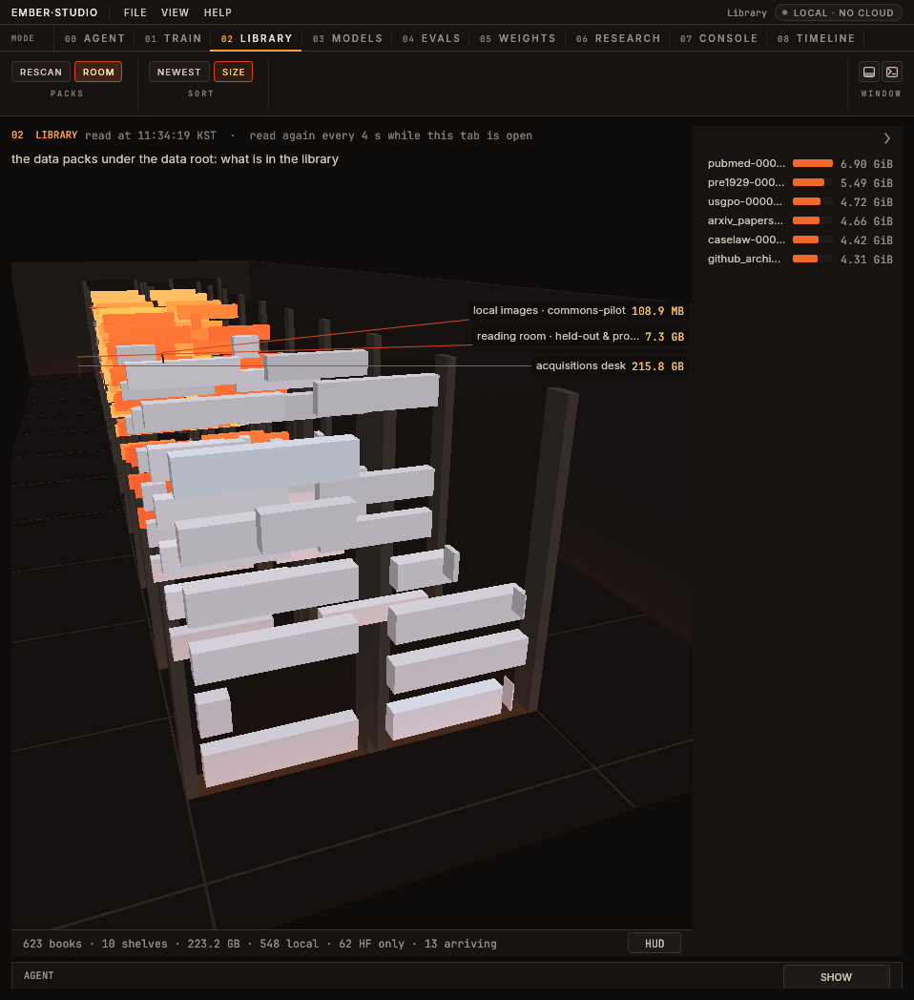

# Ember Studio

A native desktop research environment for producing, investigating and understanding AI models, built around [Ember](https://github.com/wordingone/ember). Studio draws models, data and experiments as things you look at and move around in, and it talks to a resident daemon, **ember-lab**, that owns every training run and model server.

*The Library tab in its 3D room view: the data packs drawn as books on shelves, with a footer that counts books, shelves, local, Hugging Face only and arriving. More screenshots and recordings are in the [tab guides](docs/tabs/).*

**Status: preview (v0.5.0). No release has been published yet**, so there is nothing to download today. The documentation here was checked against build `de6494fe` of the program's source. Studio needs ember-lab to start or watch anything: Studio is the client, and the lab owns every training run and model server. Without a lab, Studio opens and says in words that the lab is not answering. Studio runs on Windows; no Linux or macOS build exists, and [what blocks them](docs/platforms.md) is written down. Several parts are read-only viewers while the lab learns new job kinds; each guide says exactly what works. Expect breaking changes. No date is promised for a release.

## What it does today

- **Nine tabs** over your own folders and a running lab: Agent, Train, Library, Models, Evals, Weights, Research, Console, Timeline (below).
- **An agent that works in one folder under approvals**, using the lab's resident model or any model you name in a provider config file (`model`: `provider/model`). Long sessions are counted by the model's own tokenizer and summarised by the model when they near the context limit; the state line shows prompt-read time and first-token time as two numbers. See [Agent](docs/tabs/agent.md).
- **A lab whose folders are settings**: the card lock, press records, tools, model files, mail, logs and the custody drive come from `ember-lab.toml` or environment variables, not from paths built into the program. `ember-lab paths` prints them. See [lab](docs/lab.md).
- **Every control has a stable name**, so a script or an agent can read and operate the window without the mouse and without taking the keyboard focus: `ui-tree`, `ui-sweep`, `--act`, `--act-set`, and `monitor --render-png` to draw any tab to a picture without a window. See [command line](docs/command-line.md) and the [command reference](docs/interface/commands.md).

## Download

| Platform | Build | Status |
| --- | --- | --- |
| Windows 10/11, x64 | a zip named `ember-studio-<release tag>-windows-x64.zip` on the [Releases page](https://github.com/wordingone/ember-studio/releases), with a checksum file | none published yet; see the [release note](docs/releases/0.5.0-de6494fe.md) for the build the docs were checked against |
| Linux | none | compiled and drew in WSL on an earlier build, tests not passing; see [platforms](docs/platforms.md) |
| macOS | none | not built; see [platforms](docs/platforms.md) |

When a release exists, verify the download against its checksum file before you run it. Step by step: [docs/install.md](docs/install.md).

## Quick start (Windows, once a release exists)

1. Unzip, then run `ember-studio.exe` (no installer, no console window).
2. The window opens on the Agent tab the first time and on the tab you were last on after that. Press `Ctrl+9` for Agent or `Ctrl+1` to `Ctrl+8` for the others.
3. Studio reads files on your machine and asks ember-lab questions over a local pipe. With no lab running, the parts that need it say so in words.
4. Point a page at your data with a flag, for example `ember-studio.exe monitor --models-root <folder of models> --data-root <folder of data packs>`. The full list of roots is in [docs/command-line.md](docs/command-line.md).

Start with [Getting started](docs/getting-started.md).

## What Studio is for

Studio is built around five capabilities. Where each stands today is in [Getting started](docs/getting-started.md#the-five-capabilities-and-what-works-today).

- **Construct**: architectures, datasets, training pipelines.
- **Experiment**: configure, queue, run and compare experiments.
- **Inspect**: weights, activations, representations, how a checkpoint differs from its parent.
- **Investigate capability**: score what a model can do, find weaknesses, test an intervention.
- **Automate research**: agents that design and run experiments, with a human approving.

## The nine tabs

| Tab | What it is | Guide |
| --- | --- | --- |
| 00 Agent | A chat with the resident model that reads and edits files in a working folder you choose, with approvals | [agent](docs/tabs/agent.md) |
| 01 Train | The job the lab is running now; start, watch and stop an hour; charts of past hours | [train](docs/tabs/train.md) |
| 02 Library | The data library as a 3D room or a size-sorted list | [library](docs/tabs/library.md) |
| 03 Models | The models in play, the checkpoint lineage, and a side by side compare | [models](docs/tabs/models.md) |
| 04 Evals | Transplant pairs against a significance bar, and the old held-out score per hour | [evals](docs/tabs/evals.md) |
| 05 Weights | How much of the weights each hour changed | [weights](docs/tabs/weights.md) |
| 06 Research | A research project file, 3D donor and recipient networks, live experiments, a paper pane | [research](docs/tabs/research.md) |
| 07 Console | The lab's job events and the job log | [console](docs/tabs/console.md) |
| 08 Timeline | Press receipts and lab events in time order | [timeline](docs/tabs/timeline.md) |

## Documentation

- [Install](docs/install.md) and [platforms](docs/platforms.md)
- [Getting started](docs/getting-started.md) and [the five capabilities](docs/capabilities.md)
- [The window: menus, ribbon, docks, keys](docs/window.md)
- [How Studio talks to ember-lab](docs/lab.md)
- [Command line and driving Studio from scripts](docs/command-line.md)
- [Command reference](docs/interface/commands.md): every command a script or agent may send, with its [schema](docs/interface/commands.schema.json)
- [File formats](docs/formats/README.md): schemas and examples for the files the program reads and writes
- [How the program is built](docs/architecture.md): the sixteen packages and the rule between them (the source itself is not here)
- Examples: [agent scripts](examples/agents/README.md) and [job and experiment manifests](manifests/)
- [Troubleshooting](docs/troubleshooting.md), [known limits](docs/known-limits.md), [screen recordings](docs/media/README.md)
- [Changelog](CHANGELOG.md) and [roadmap](ROADMAP.md)

## Contributing

This repository holds documentation, formats, manifests, examples, checks and, once published, pointers to released builds. It does not hold the program's source, and a pull request that adds source is closed. A pull request here can change documents, formats, manifests, examples and agent scripts; it cannot change program behaviour. Read [CONTRIBUTING.md](CONTRIBUTING.md) first; agents read [AGENTS.md](AGENTS.md). Issues are welcome; [known limits](docs/known-limits.md) lists what is missing and is a good place to start one.

## License

The contents of this repository are licensed under the [Apache License 2.0](LICENSE); see also [NOTICE](NOTICE). Released program files carry their own terms.
