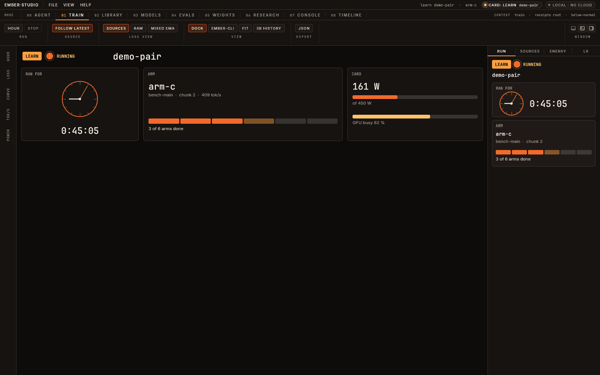

# Getting started

These guides were checked against the Windows build `de6494fe` (Ember Studio v0.5.0 preview), Windows 11. The Agent pictures, the Library room and list pictures and the Train mode strip picture were drawn on that build; the other pictures were drawn on `edb7d3ad` and the recordings and 3B history pictures on `185b8abd`, and each guide says so beside the picture. No release has been published yet. Where something is not working yet it is in [Known limits](known-limits.md), never described here as a feature.

## 1. Install and open

Follow [install](install.md), then run `ember-studio.exe`. A single window titled "Ember Studio" opens, on the Agent tab (the tab you were last on is reopened only if this version remembered it). Studio is a Windows GUI program: no console opens with it, and closing the terminal you started it from does not close it.

Only one Studio window can exist on a machine. Starting a second one opens nothing; it hands its arguments to the first window, prints `STUDIO_ALREADY_RUNNING pid=<n>` and exits. See [command line](command-line.md).

## 2. Read the window



Top to bottom:

- **Menu bar**: FILE, VIEW, HELP, then two chips on the right. On Train the first names what is holding the GPU card right now (in the picture, a made-up learn job; the picture is an offscreen render from an earlier build, see [how the pictures were made](tabs/train.md#how-the-pictures-were-made)); the second reads LOCAL · NO CLOUD and opens a sentence saying what Studio reads and talks to ([window](window.md)).
- **Mode tabs**: `00 AGENT` through `08 TIMELINE`. `Ctrl+9` opens Agent and `Ctrl+1` to `Ctrl+8` open the others. A tab the lab cannot serve is drawn disabled, with the reason on hover.
- **Ribbon**: the buttons of the current tab, in labelled groups. A disabled button carries the reason it is off (`ui-tree` prints it; see [command line](command-line.md)).
- **Page**: the tab itself. Most pages re-read their sources every 4 seconds while the tab is open and say when they last read.
- **Agent dock**: the agent docked at the foot of every other tab, the same session as the Agent tab; `Ctrl+J` shows or hides it.

[The window](window.md) lists every shell control.

## 3. Tell Studio where your files are

Studio is a client of two things: files on your disk and a running ember-lab. No lab has been released yet, so what needs one does not work on your machine until you have one. A page whose source is not configured says which flag to give, in words, for example `no models folder is configured: pass --models-root DIR`. Start Studio with the roots you have:

```
ember-studio.exe monitor --models-root <models folder> --data-root <data packs folder> --learn-root <learn runs folder>
```

The full list of roots, and what each tab reads, is in [command line](command-line.md#roots-the-pages-read).

## 4. The five capabilities and what works today

Studio is organised around five things a research environment must let you do. This is the honest state of each in this build.

| Capability | What you can do today | What you cannot do yet |
| --- | --- | --- |
| Construct | See the models on disk, grouped by role ([models](tabs/models.md)). The Research tab has project-file buttons (NEW, OPEN, SAVE, ADD EXPERIMENT, ADD HYPOTHESIS, ADD MODEL) that this guide did not exercise ([research](tabs/research.md)) | Draw or edit an architecture, compose datasets into a mixture, edit a training pipeline |
| Experiment | Start, watch and stop a governed training hour through the lab ([Hour view](tabs/hour-view.md), [train](tabs/train.md)); read finished and running jobs ([console](tabs/console.md), [timeline](tabs/timeline.md)) | A saved experiment form with typed hyperparameters, a queue, a compare view of two runs' hyperparameters |
| Inspect | A two-model compare frame on Models ([models](tabs/models.md#compare)); the transplant edits of each arm and a tower of the live model's layers with their tensors ([weights](tabs/weights.md)); donor and recipient networks drawn in 3D with their layers ([research](tabs/research.md)) | Activations, attention maps and gradients on a prompt |
| Investigate capability | Read transplant pairs scored against a 3 SE bar, with donor and recipient scores ([evals](tabs/evals.md)) | Start an evaluation from Studio, write a hypothesis against a weakness and link the test |
| Automate research | Chat with a model (the lab's resident model, or any model you name in a provider config file) that reads and edits files in a working folder you choose, under approvals ([agent](tabs/agent.md)) | A proposal inbox where an agent files an experiment for you to approve |

## 5. A first ten minutes

1. Open **02 Library**. Press ROOM to switch between the 3D room and the size-sorted list ([library](tabs/library.md)).
2. Open **03 Models**. Press 3B LINEAGE and back; press COMPARE to see the two-model frame ([models](tabs/models.md)).
3. Open **04 Evals**. Each dot is a donor and recipient pair; the dashed line is the 3 SE bar ([evals](tabs/evals.md)).
4. Open **06 Research**. Switch the experiment with the buttons above the two networks, and filter by layer ([research](tabs/research.md)).
5. Open **01 Train**. Above the page is the mode strip (finetuning with its three methods, pretraining dormant). With a lab answering, the cards follow its running job; press 3B HISTORY to see the charts of the earlier training hours ([train](tabs/train.md)). HOUR opens the form for starting an hour ([Hour view](tabs/hour-view.md)).
6. Open **00 Agent** (Studio opens on it). It needs a lab for the resident model, or a provider config file for another one; then give it a working folder and ask it about a file ([agent](tabs/agent.md)).

Short screen recordings of each of these are in [media](media/README.md).

## 6. Drive Studio from a script

Every control has a stable name and can be operated without a mouse and without taking the keyboard focus: `ember-studio.exe --act mode.evals` switches the running window to Evals. See [command line](command-line.md).
