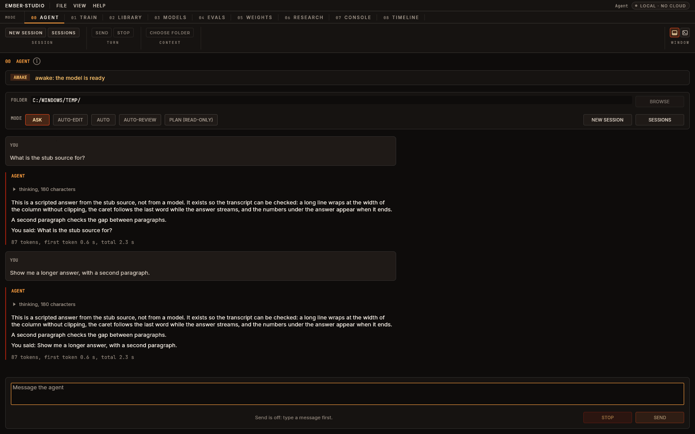
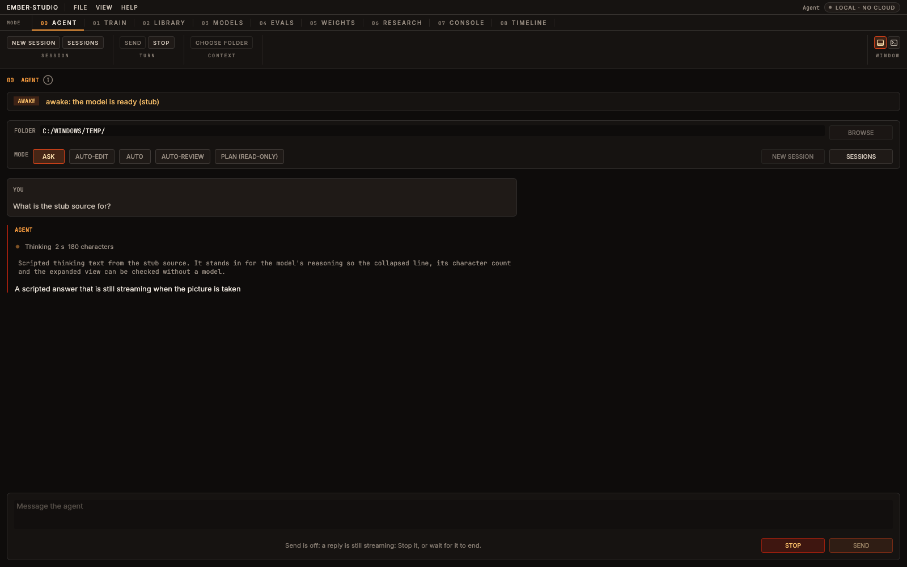
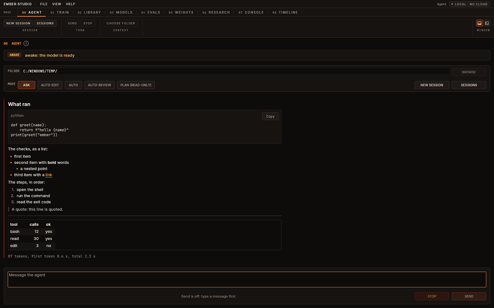
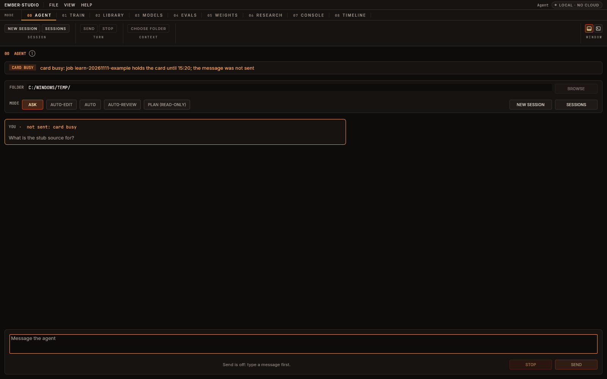

# 00 Agent

A chat with a model that can read and edit files in one working folder you choose, under approvals you control. The model is the lab's resident model by default, or any model you name in a provider config file ([below](#choosing-the-model)). The pictures were drawn by build `de6494fe`.

> Every picture on this page is drawn on a scripted conversation (`monitor --render-png` with `--agent-stub`), not a live model, so that no real session is published. The window and its controls are the real ones. There is no screen recording of this tab for the same reason; see [Known limits](../known-limits.md). The compaction and cut-reason notes below have no picture: the scripted conversations do not produce them.

## What it shows



Top to bottom:

- **State line**: a chip and a sentence, in words. The states this build draws:
  - `COLD`: no model process is running yet; sending a message starts it.
  - `WAKING`: the model is starting.
  - `AWAKE`: the model is ready.
  - `ASLEEP`: idle (sending a message wakes it), or asleep because something else holds the GPU card and it wakes when the card comes back. How long it idles before sleeping is a setting: see [lab](../lab.md#settings-that-are-not-folders).
  - `YIELDING` and `YIELDED`: the agent gives the card to a job that needs it. While it is ending the resident model the line says so, with the job it yields to; when the card is back it wakes. If the model does not exit, the line says `yield failed` and names the process and the wait. The card chip beside the line shows the predicted wake time (for example `wakes ~9:52 AM`), the time left, and `yielded for H:MM:SS`.
  - `CARD BUSY`: a job holds the card and the message was not sent.
  - `SENDING`: a message is on its way to a lab that has not answered; Send is off and the typed text stays in the box.
  - an error in words.
- **FOLDER** and **BROWSE**: the one folder the agent may read and edit in. Nothing can be sent until a folder exists, and no folder is built in. BROWSE opens the Windows folder dialog on your own click; you can also type the folder. The choice is remembered in Studio's settings file and is the default for new sessions. A line under it says what the mode means in this folder.
- **MODE**: ASK, AUTO-EDIT, AUTO, AUTO-REVIEW, PLAN (READ-ONLY).
  - ASK (the default): every file edit and every shell command asks first. Reads never ask.
  - AUTO-EDIT: edits inside the working folder go through; edits outside it and every shell command still ask.
  - AUTO: edits and shell commands run without asking, except edits outside the working folder, which always ask.
  - AUTO-REVIEW: nothing asks you. Calls covered by the seat's rules go through, calls on an always-refused list are refused, and the rest are judged by a reviewer the lab runs on the CPU; a call the reviewer cannot judge is refused.
  - PLAN (READ-ONLY): the agent can read, glob and grep; edits and commands are refused, so it can only explore and propose a plan.
- **NEW SESSION** and **SESSIONS**: save this session and start an empty one, and open the list of saved sessions (title, age, turn count, and a dot for a turn that arrived since you last looked). The tab resumes the most recent session when you open it.
- **Transcript**: your messages in boxes marked YOU; the agent's with a bar down the left, marked AGENT. Answers are drawn as markdown. A collapsed `thinking, N characters` line opens the model's thinking. Under a finished answer: tokens, time to first token and total time. Tool calls appear as lines (a line opens the whole input), with a diff for an edit, and `waiting for your decision` with APPROVE and DENY buttons when a mode asks. A shield on a call says the auto-review gate ruled on it; a stop sign says one of the seat's hooks blocked it. A turn the lab started itself, such as one from mail or a loop, is drawn as one collapsed line (for example `Mail from <sender>`) and never as YOU.
- **Message box**, **SEND** and **STOP**: Enter sends and Shift+Enter adds a line. Send is off, with its reason written under the box, while the box is empty, no folder is set, a reply is streaming or a message is being sent. STOP ends a streaming reply and keeps what had streamed.

The same agent is docked at the foot of every other tab; `Ctrl+J` shows or hides it there.

## The state line while a turn runs

When the lab says what a turn is doing, the state line says it in words:

- `reading prompt 83,000/204,000 tokens (40%, about 1,050 tokens a second)`: the server is reading the conversation so far.
- `compacting: reading prompt ...` and `compacting: writing the summary (N characters so far)`: see [Long sessions](#long-sessions-compaction).
- `thinking (prompt read 2.5 min, first token after 2.5 min)` and `writing the answer (prompt read 900 ms, first token after 1.4 s)`.
- `running <tool>`, `waiting for approval: ...`, `waiting for the card`, and `retrying (attempt 2 of 3, after: ...)` when a request to the model failed and is tried again.

**Two numbers, never one.** *Prompt read* is how long the server spent reading the prompt: the server's own clock for its newest prompt-progress report. *First token* is when the first token the model itself generated arrived (a thinking prefix the lab writes in front is not counted). A long conversation can take minutes to read before anything is generated, so a single "time to first token" would hide that. Times are shown as milliseconds, seconds or minutes. A lab that does not report them leaves the plain word, for example `thinking`. The line under a finished answer is still `N tokens, first token X s, total Y s`.

Which of these a lab reports, and when, was read from the source and its tests; it was not run against a live model for this guide.

## Choosing the model

By default the agent talks to the lab's resident model on the GPU card. To use another model, put an opencode-style provider config file where the lab looks for it. The lab reads these files, in this order, and a later file replaces an earlier provider with the same id. Only files that exist are read:

1. `opencode.jsonc` or `opencode.json` in `.config/opencode` under your user folder (where opencode itself keeps it),
2. the file named by the environment variable `EMBER_AGENT_OPENCODE_CONFIG`,
3. `opencode.jsonc` or `opencode.json` in the lab's seat folder (the `seat.home` [setting](../lab.md#where-the-lab-keeps-things-and-how-to-change-it)),
4. `opencode.jsonc` or `opencode.json` in the working folder of the session, so a project can carry its own.

It is JSON, and comments and trailing commas are allowed. A minimal file:

```jsonc
{
  "model": "local/my-model",
  "provider": {
    "local": {
      "options": { "baseURL": "http://127.0.0.1:8081/v1" },
      "models": { "my-model": { "limit": { "context": 131072 } } }
    }
  }
}
```

- **`model`** is `provider/model`: the default model for every session. `EMBER_AGENT_PROVIDER_MODEL` overrides it for one run. With no `model` key the resident model, `ember-resident/qwen`, is used.
- **`provider.<id>`** takes `name`, `npm`, and `options` with `baseURL`, `apiKey`, `headers` and `timeout` (milliseconds, default 300000). `npm` may be left out or be `@ai-sdk/openai-compatible`; any other adapter makes that provider unusable and says so.
- **`models.<id>`** takes `name`, `limit.context`, `limit.output`, `tool_call`, `reasoning`, `options` and `quirks`. `quirks` holds `reasoningField`, `maxTokensField`, `streamUsage`, `foldSystem` and `llamaSampling`; a quirk key the lab does not know is reported and ignored. A provider that lists no models passes any model id through.
- Values may be written `{env:NAME}` (an environment variable) or `{file:path}` (the contents of a file). A variable that is not set, or a file that cannot be read, is an error that names it; a relative file path is read from the folder of the config file.
- **Only plain `http://` addresses** (`http://host[:port][/prefix]`) are supported. An `https://` address is refused with a sentence that says to run a local OpenAI-compatible server or a local proxy. Studio and the lab contain no TLS client.
- The model must call tools; `tool_call: false` makes it unusable, because the agent edits files through tools.
- Every other key of an opencode file (plugins, themes, agents, MCP servers and so on) is not read; the lab lists each one it ignored.

When a model is chosen, the lab asks the server which models it serves and what its context is (`GET /v1/models`, and `GET /props` for a llama.cpp server) and uses the context the file gives, else the one the server reports. The server is yours: the lab does not start, wake, stop or card-lock it, and a turn on it does not wait for the GPU card.

The lab's `capabilities` answer lists the models it knows and why one is off, and the Agent tab turns itself off, with that reason, when the chosen default model cannot be served (or when the resident model's server file is not usable). Because the conversation is sent to the server you name, "nothing leaves this machine" is true of Studio, and of the agent only while that server is on this machine.

Not verified for this guide: a turn against a real external server. The file format and the checks above were read from the source and its tests.

## Long sessions (compaction)

When a session grows close to the model's context window, the lab asks the same model to summarise it, and the session continues from that summary. The trigger is the smaller of 85 percent of the context and a configured size (`EMBER_AGENT_COMPACT_AT`, default 340,000 tokens, less a margin). With a 240,000-token context that is 204,000 tokens.

After a compaction the model is given one message holding the summary, your first request word for word, your most recent request word for word, and the path of a file that keeps the replaced messages. Studio keeps the whole transcript on screen, marks the point with `[earlier messages were summarised]`, and draws a small squeezing-chevrons mark on the turn, with the token sizes before and after on hover. While it runs the state line says `compacting`. The `/compact` command is listed as `not in Studio yet`.

**Exact token counts.** The size of a session is the count the model server reports for the prompt, kept with each answer. For a session with no such count the lab asks the server's own tokenizer (`POST /tokenize`), not a guess from the number of characters; the character estimate overstated the size by 1.6 to 1.8 times, and is used only when the server cannot be asked.

## When a turn is cut

A turn the lab had to cut says why, in words, under the turn: `cut: <reason>`, for example `cut: thinking budget of 10240 tokens reached`. The reasons are the thinking budget, the limit on tokens for one answer, and a stream that broke. A note `stopped at the token limit: N tokens, M of them thinking` says an answer ended at the limit. If a model stops after thinking and writes no answer, the thinking is shown as the answer, with the note `the model ended without a separate answer; its thinking is shown here as the answer`. A cut is never silent.

## Answers that stream, and answers with structure

While a reply streams, STOP is live and Send says why it is off. Thinking is drawn open as it arrives, under a line such as `Thinking 2 s 180 characters`:



Finished answers draw headings, code with a Copy button, lists, a quote, a link and a table:



## When the card is not available

A busy card is a state, not an error: a job holds the GPU and the line names the job and the time it holds the card.

In **AUTO-REVIEW** the lab queues a message sent while the card is yielded or held. It shows in the transcript as `queued` with a Delete control, survives a lab restart, and is started first when the card is free. In the other modes the message did not start; it stays in the transcript marked `not sent: card busy` and never runs later, so send it again when the card is free.



When the agent is asked to give the card up for a job it shows `YIELDING`, which job, and how long it has been yielded:


Typed turns in AUTO-REVIEW run in the lab, not in Studio, so closing Studio does not cancel one: a window opened later follows a turn that is still running. The other modes run the turn as a child process of Studio. A model that is not the resident one needs no card, so none of the card states apply to it.

Approvals, the session list and a real model turn were not drawn for this guide.

## Slash commands

Type `/` in the message box to list the lab's commands and skills, each with a status; one Studio does not run yet is greyed and says `not in Studio yet`. `/clear` opens a new session, `/resume` opens the saved sessions, `/plan` switches to PLAN, and `/help` says how many are listed. `/new-command` opens a form that writes `.ember/commands/<name>.md` in the working folder; the command is in the list the next time it opens, with no restart. Any other line that starts with `/` and is not in the list is sent as a message.

## Controls

| Group | Control | What it does |
| --- | --- | --- |
| SESSION | NEW SESSION / SESSIONS | New session; list of saved sessions |
| TURN | SEND / STOP | Send the message; stop the reply |
| CONTEXT | CHOOSE FOLDER | The folder dialog, shown while no folder is chosen |
| page | ASK / AUTO-EDIT / AUTO / AUTO-REVIEW / PLAN | The mode; the one in use is disabled, with `this is the mode in use` |

## A typical task: ask the agent to read a file

1. Open Agent. Wait for AWAKE (or send a first message from COLD; the model starts).
2. Type the working folder in FOLDER, or press BROWSE.
3. Leave MODE on ASK. Type a question about a file in that folder and press Enter.
4. Read the streamed answer. Reads happen without asking. If the agent proposes an edit, a tool line shows it and waits; press APPROVE or DENY.

## Driving it from a script

The Agent tab can be driven without a mouse and without taking the keyboard focus: `ember-studio --act-set agent.input "<text>"` fills the box, `--act-set agent.folder "<folder>"` sets the folder, and `ember-studio --act agent.send` sends the turn. `--act-clear` empties a box. The folder dialog never opens from a script; type the folder instead. Read the answer back with `ui-tree`. This is the documented route; it was not run for this guide, because it would send a real turn to a model. See [command line](../command-line.md).
