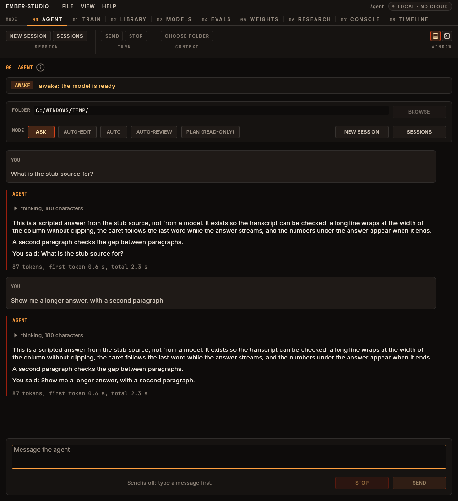

# 00 Agent

A chat with the lab's resident model, which can read and edit files in one working folder you choose, under approvals you control. Checked on build `185b8abd`.

> The screenshots on this page are drawn on a scripted conversation (`ui-tree` and `monitor --render-png` with `--agent-stub`), not a live model, so that no real session is published. The window and its controls are the real ones. There is no screen recording of this tab for the same reason; see [Known limits](../known-limits.md).

## What it shows

Top to bottom:

- **State line**: a chip and a sentence. `AWAKE` (the model is ready), `COLD` (no model process is running yet; sending a message starts it), `YIELDED` (the agent has yielded the GPU card to a running job; the running window showed it next to COLD), and error states in words.
- **FOLDER** and **BROWSE**: the one folder the agent may read and edit in. Nothing can be sent until a folder exists. BROWSE opens the Windows folder dialog on your own click; you can also type the folder.
- **MODE**: ASK, AUTO-EDIT, AUTO, AUTO-REVIEW, PLAN (READ-ONLY).
  - ASK (the default): every file edit and every shell command asks first. Reads never ask.
  - AUTO-EDIT: edits inside the working folder go through; edits outside it and every shell command still ask.
  - AUTO: edits and shell commands run without asking, except edits outside the working folder, which always ask.
  - AUTO-REVIEW: a reviewer decides each call. It needs permission files in the folder's `.ember` directory.
  - PLAN (READ-ONLY): read-only.
- **NEW SESSION** and **SESSIONS**: save this session and start an empty one, and open the list of saved sessions. The tab resumes the most recent session when you open it.
- **Transcript**: your messages in boxes marked YOU; the agent's with a bar down the left, marked AGENT. A collapsed `thinking, N characters` line opens the model's thinking. Under a finished answer: tokens, time to first token and total time. Tool calls appear as lines such as `WRITE_FILE <path> · ok`, and, by the program's control names, `waiting for your decision` with APPROVE and DENY buttons when a mode asks (an approval was not triggered while writing this guide).
- **Message box**, **SEND** and **STOP**: Enter sends and Shift+Enter adds a line. Send is off, with its reason written beside it, while the box is empty, no folder is set, or a reply is streaming. STOP ends a streaming reply and keeps what had streamed.

A busy card is a state, not an error: a job holds the GPU, the message did not start, and Send tries again.

## Controls

| Group | Control | What it does |
| --- | --- | --- |
| SESSION | NEW SESSION / SESSIONS | New session; list of saved sessions |
| TURN | SEND / STOP | Send the message; stop the reply |
| CONTEXT | CHOOSE FOLDER | The folder dialog, shown while no folder is chosen |

## A typical task: ask the agent to read a file

1. Open Agent. Wait for AWAKE (or send a first message from COLD; the model starts).
2. Type the working folder in FOLDER, or press BROWSE.
3. Leave MODE on ASK. Type a question about a file in that folder and press Enter.
4. Read the streamed answer. Reads happen without asking. If the agent proposes an edit, a tool line shows the diff and waits; press APPROVE or DENY.

## Driving it from a script

The Agent tab is the one tab a script can type into: `ember-studio --act-set agent.input "<text>"` fills the box and `ember-studio --act agent.send` sends the turn, with no mouse and no keyboard focus taken. Read the answer back with `ui-tree`. This is the documented route; it was not run for this guide, because it would send a real turn to the model. See [command line](../command-line.md).
