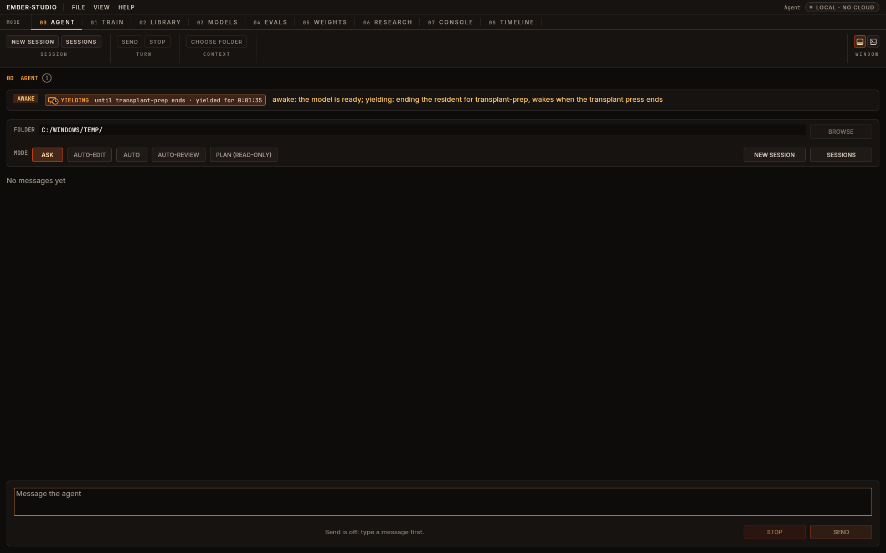

# 00 Agent

A chat with the lab's resident model, which can read and edit files in one working folder you choose, under approvals you control. The pictures were drawn by build `be2abf05`.

> Every picture on this page is drawn on a scripted conversation (`monitor --render-png` with `--agent-stub`), not a live model, so that no real session is published. The window and its controls are the real ones. There is no screen recording of this tab for the same reason; see [Known limits](../known-limits.md).

## What it shows

Top to bottom:

- **State line**: a chip and a sentence, in words. The states this build draws:
  - `COLD`: no model process is running yet; sending a message starts it.
  - `WAKING`: the model is starting.
  - `AWAKE`: the model is ready.
  - `ASLEEP`: idle (sending a message wakes it), or asleep because something else holds the GPU card and it wakes when the card comes back.
  - `YIELDING` and `YIELDED`: the agent gives the card to a job that needs it. While it is ending the resident model the line says so, with the job it yields to and a `yielded for H:MM:SS` clock; when the card is back it wakes. If the model does not exit, the line says `yield failed` and names the process and the wait.
  - `CARD BUSY`: a job holds the card and the message was not sent.
  - `SENDING`: a message is on its way to a lab that has not answered; Send is off and the typed text stays in the box.
  - an error in words.
- **FOLDER** and **BROWSE**: the one folder the agent may read and edit in. Nothing can be sent until a folder exists. BROWSE opens the Windows folder dialog on your own click; you can also type the folder. A line under it says what the mode means in this folder.
- **MODE**: ASK, AUTO-EDIT, AUTO, AUTO-REVIEW, PLAN (READ-ONLY).
  - ASK (the default): every file edit and every shell command asks first. Reads never ask.
  - AUTO-EDIT: edits inside the working folder go through; edits outside it and every shell command still ask.
  - AUTO: edits and shell commands run without asking, except edits outside the working folder, which always ask.
  - AUTO-REVIEW: a reviewer decides each call. It needs permission files in the folder's `.ember` directory.
  - PLAN (READ-ONLY): read-only.
- **NEW SESSION** and **SESSIONS**: save this session and start an empty one, and open the list of saved sessions. The tab resumes the most recent session when you open it.
- **Transcript**: your messages in boxes marked YOU; the agent's with a bar down the left, marked AGENT. A collapsed `thinking, N characters` line opens the model's thinking. Under a finished answer: tokens, time to first token and total time. Tool calls appear as lines, and `waiting for your decision` with APPROVE and DENY buttons when a mode asks.
- **Message box**, **SEND** and **STOP**: Enter sends and Shift+Enter adds a line. Send is off, with its reason written under the box, while the box is empty, no folder is set, a reply is streaming or a message is being sent. STOP ends a streaming reply and keeps what had streamed.

## Answers that stream, and answers with structure

While a reply streams, STOP is live and Send says why it is off:

Finished answers draw headings, code with a Copy button, lists, a quote, a link and a table:

## When the card is not available

A busy card is a state, not an error: a job holds the GPU, the message did not start, and the line names the job and the time it holds the card. The message stays in the transcript, marked `not sent: card busy`.

When the agent is asked to give the card up for a job it shows `YIELDING`, which job, and how long it has been yielded:

Approvals, the session list and a real model turn were not drawn for this guide.

## Controls

| Group | Control | What it does |
| --- | --- | --- |
| SESSION | NEW SESSION / SESSIONS | New session; list of saved sessions |
| TURN | SEND / STOP | Send the message; stop the reply |
| CONTEXT | CHOOSE FOLDER | The folder dialog, shown while no folder is chosen |
| page | ASK / AUTO-EDIT / AUTO / AUTO-REVIEW / PLAN | The mode; the one in use is disabled, with `this is the mode in use` |

## A typical task: ask the agent to read a file

1. Open Agent. Wait for AWAKE (or send a first message from COLD; the model starts).
2. Type the working folder in FOLDER, or press BROWSE.
3. Leave MODE on ASK. Type a question about a file in that folder and press Enter.
4. Read the streamed answer. Reads happen without asking. If the agent proposes an edit, a tool line shows it and waits; press APPROVE or DENY.

## Driving it from a script

The Agent tab is the one tab a script can type into: `ember-studio --act-set agent.input "<text>"` fills the box and `ember-studio --act agent.send` sends the turn, with no mouse and no keyboard focus taken. Read the answer back with `ui-tree`. This is the documented route; it was not run for this guide, because it would send a real turn to the model. See [command line](../command-line.md).
