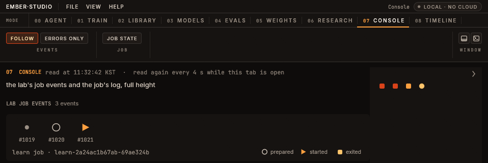

# 07 Console

The lab's events for a job, and the tail of the job's log. Checked on build `185b8abd`.

## What it shows

*The screenshot is cropped to the top of the page. Below the strip the page prints the log tail: a table of line numbers and text, as many lines as fit the height.*

- **Lab job events**: a strip of numbered events for the job the lab lists (the running one, else the newest), each with a symbol (prepared, started, exited) and a legend. Under it the job's kind and id.
- **Job log**: the tail of the log file the followed job writes. The page says how many lines it read and that the file is read from its last bytes.
- The right panel is a row of status dots for the events.

If no press receipts file is configured the page says so and names the flag.

## Controls

| Group | Control | What it does |
| --- | --- | --- |
| EVENTS | FOLLOW | On by default; by its label it keeps the view at the newest lines (not pressed while writing this guide) |
| EVENTS | ERRORS ONLY | Keeps only error lines. When the log has none the page says "no row of this page is error lines" and how many rows were all cut |
| JOB | JOB STATE | Asks the lab again; a note appears in the menu bar saying the job state, events and the log tail are being read again |

*Recording: [console.mp4](../media/console.mp4), cropped to the top of the page.*

## A typical task: see why a job stopped

1. Open Console. Check the last event in the strip: exited or stopped.
2. Press ERRORS ONLY. If any error lines exist they stay; if not, the page tells you the log has none.
3. Press JOB STATE after the job ends to re-read the lab's final word.
