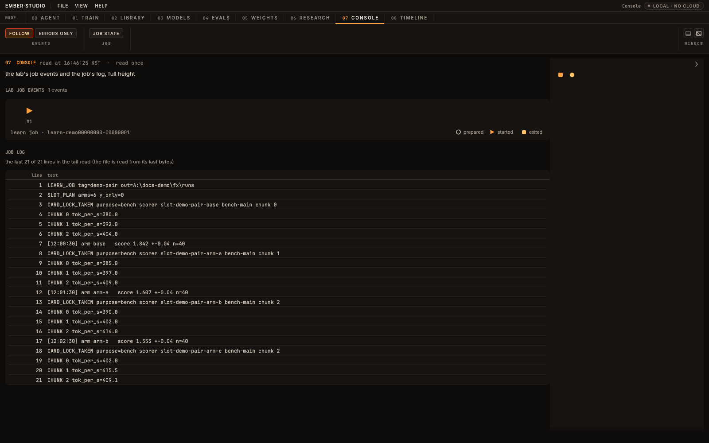
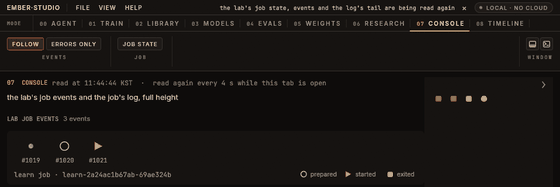

# 07 Console

The lab's events for a job, and the tail of the job's log. The picture was drawn by build `be2abf05` offscreen on made-up data (see [how the pictures were made](train.md#how-the-pictures-were-made)); the recording was made on `185b8abd`.

## What it shows

- **Lab job events**: a strip of numbered events for the job the lab lists (the running one, else the newest), each with a symbol: a hollow circle for prepared, a triangle for started, a filled square for exited, with the legend at the right. Under it the job's kind and id (`learn job` and its id in the picture; one event, `started`, so far).
- **Job log**: the tail of the log file the followed job writes. A line says how many lines it read (`the last 21 of 21 lines in the tail read`) and that the file is read from its last bytes. Below it, a table of line numbers and text, as many lines as fit the height.
- The right panel is a row of status dots for the events.

The page reads once per visit and says when (`read at ... · read once`). If no press receipts file is configured it says so and names the flag.

## Controls

| Group | Control | What it does |
| --- | --- | --- |
| EVENTS | FOLLOW | On by default; by its label it keeps the view at the newest lines |
| EVENTS | ERRORS ONLY | Keeps only error lines. When the log has none the page says "no row of this page is error lines" and how many rows were all cut |
| JOB | JOB STATE | Asks the lab again; a note appears in the menu bar saying the job state, events and the log tail are being read again |

Not pressed for this guide on `be2abf05`: all three. They were operated on `185b8abd`:

*Recording: [console.mp4](../media/console.mp4), cropped to the top of the page, build `185b8abd`.*

## A typical task: see why a job stopped

1. Open Console. Check the last event in the strip: exited or stopped.
2. Press ERRORS ONLY. If any error lines exist they stay; if not, the page tells you the log has none.
3. Press JOB STATE after the job ends to re-read the lab's final word.
