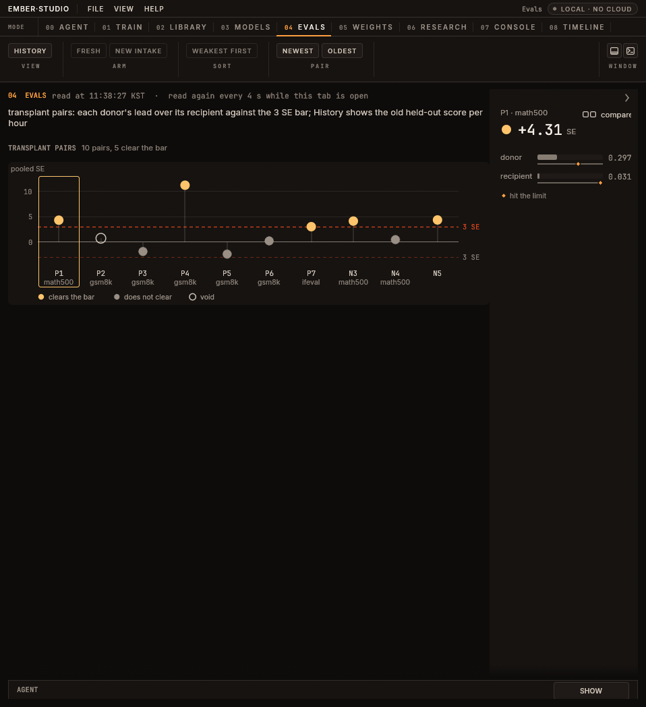

# 04 Evals

How much better a donor is than its recipient on a benchmark, against a significance bar, and the older held-out score per training hour. Checked on build `185b8abd`.

## What it shows

By default the page draws **transplant pairs**. A pair is a donor model and a recipient model scored on a benchmark; the page reads them from the transplant runs root (`--slot-root`).

- One dot per pair. The label under it is the pair's tag and the benchmark (for example `math500`, `gsm8k`, `ifeval`).
- The vertical position is the donor's lead over its recipient in pooled standard errors (SE). The dashed red line is the +3 SE bar; the grey dashed line is -3 SE.
- A filled orange dot **clears the bar**, a grey dot **does not clear** it, and a hollow dot is **void** (the measurement is not valid).
- The header counts them, for example "10 pairs, 5 clear the bar".
- Selecting a pair (the **PAIR** buttons) fills the right panel: the pair's score in SE, and the donor and recipient scores as bars, with a marker where a score hit its limit. A **compare** control in that panel opens the pair's donor and recipient side by side in the Models tab (this is what the program's own help text says; it was not pressed while writing this guide).

If no runs root is configured the page says so and gives the flag.

## History

HISTORY switches to the older **held-out score per hour** chart: one dot per scored training hour of the previous Ember model, a frozen bar as a dashed line, orange dots for hours lower than their parent and red for higher, and the weakest hour ringed. The right panel shows the selected hour's score.

## Controls

| Group | Control | What it does |
| --- | --- | --- |
| VIEW | HISTORY | Toggles between the transplant pairs and the hour history |
| ARM | FRESH / NEW INTAKE | Which held-out set the history draws. Only live while HISTORY is on |
| SORT | WEAKEST FIRST | Orders the history. Only live while HISTORY is on |
| PAIR | NEWEST / OLDEST | Selects the newest or the oldest pair. Only live while HISTORY is off |

A control that is not live right now is disabled and states why.

*Recording: [evals.mp4](../media/evals.mp4).*

## A typical task: find which pairs clear the bar

1. Open Evals. Read the header count, then look for filled orange dots above the red line.
2. Press OLDEST, then NEWEST, to step through pairs; read the right panel for the donor and recipient scores.
3. Press HISTORY to compare with the hour-by-hour score of the older model.
