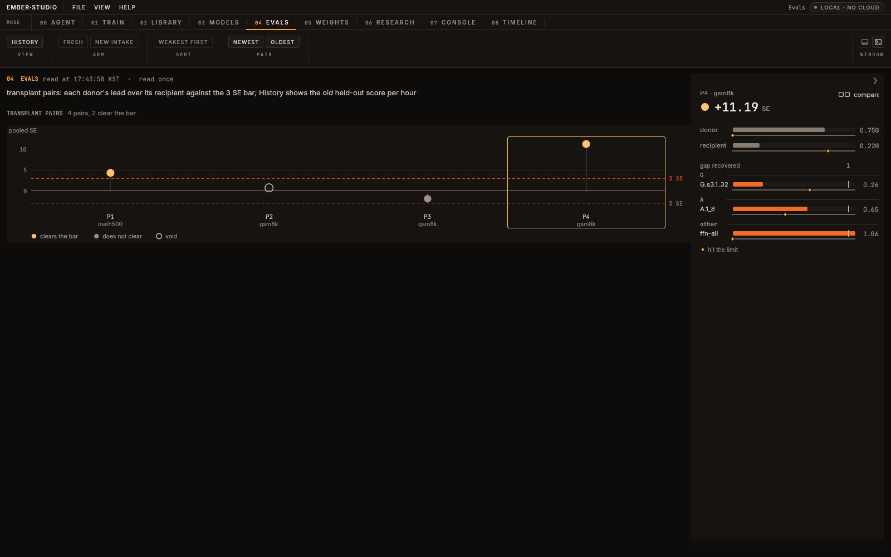
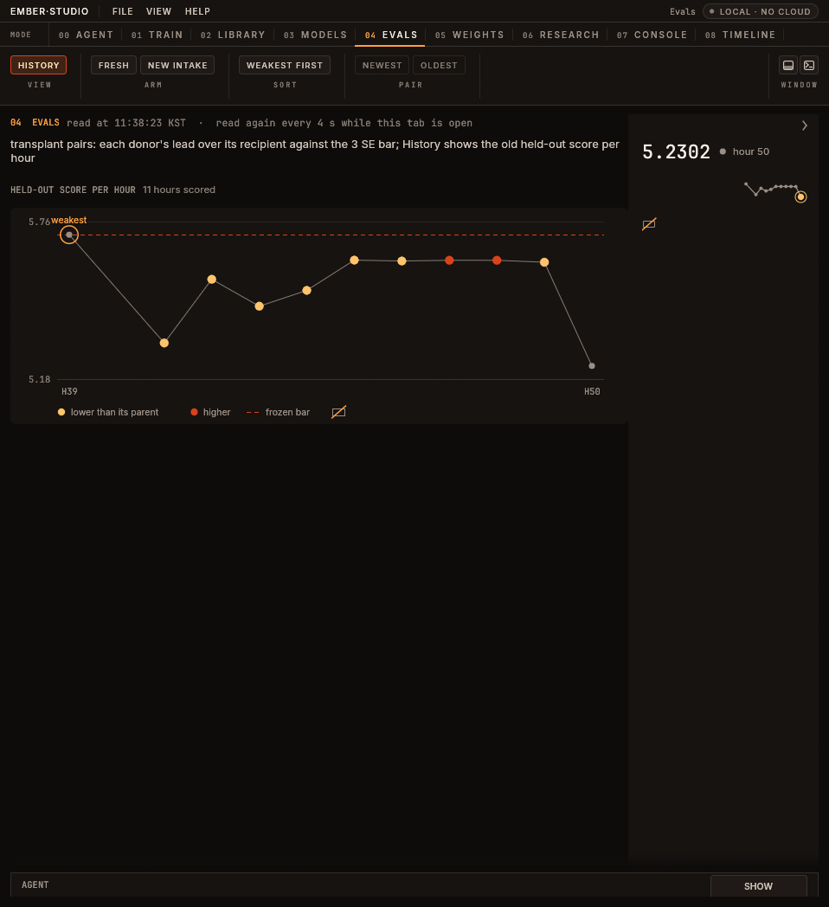
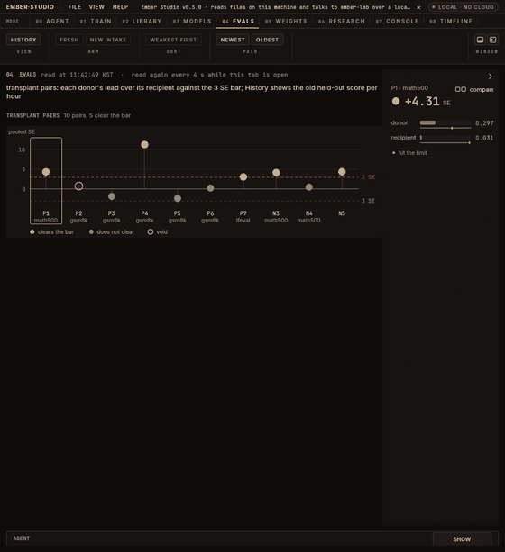

# 04 Evals

How much better a donor is than its recipient on a benchmark, against a significance bar, and the older held-out score per training hour. The pair pictures were drawn by build `edb7d3ad` offscreen on made-up data (see [how the pictures were made](train.md#how-the-pictures-were-made)); the History picture and the recording are from `185b8abd`. Neither was redrawn on the current build, `de6494fe`; what changed since is listed under [Since these pictures](#since-these-pictures).

## What it shows

By default the page draws **transplant pairs**. A pair is a donor model and a recipient model scored on a benchmark; the page reads them from the transplant runs root (`--slot-root`), one folder per press, grouped by the tag at the start of the folder's name (`p1-...` is P1).

- One dot per pair, labelled with the pair's tag and the benchmark under it (`math500`, `gsm8k` in the picture).
- The vertical position is the donor's lead over its recipient in pooled standard errors (SE). The dashed red line is the +3 SE bar; the grey dashed line is -3 SE.
- A filled orange dot **clears the bar**, a grey dot **does not clear** it, and a hollow dot is **void** (the measurement is not valid). The page takes each verdict from the run's own receipt and computes none itself.
- The header counts them (`4 pairs, 2 clear the bar`).
- The right panel shows the selected pair; with none chosen it is the newest.

Selecting a pair (the **PAIR** buttons) fills the right panel with the pair's score in SE, the donor and recipient scores as bars, and one bar per arm of the press with the share of the donor's gap that arm recovered. A small diamond under a bar marks where that arm hit its limit (the legend reads `hit the limit`). A **compare** control at the top of the panel opens the pair's donor and recipient side by side in the Models tab (not pressed for this guide).

If no runs root is configured the page says so and gives the flag: `no transplant runs root is configured: pass --slot-root DIR`.

## History

HISTORY switches to the older **held-out score per hour** chart: one dot per scored training hour of the previous Ember model, a frozen bar as a dashed line, orange dots for hours lower than their parent and red for higher, and the weakest hour ringed. The right panel shows the selected hour's score. It reads the receipts of the old 3B hours, which this guide did not redraw; the picture is from `185b8abd`.

## Since these pictures

Read from the program's manual and source for `de6494fe`; not drawn for this guide, because it needs run folders to draw from.

- A pair whose run has no gap yet is drawn as a pending glyph, a dashed ring on the zero line, and the legend gains a `pending` entry. A pair is never dropped from the page.
- The `compare` control in the pair's panel opens the pair's donor as A and its recipient as B in the Models tab, with the pair's delta map, when one is read, drawn as a band of difference marks (see [Models](models.md#compare)).
- The History chart draws a run-to-run noise band only from a measured band file (`--band-file`, or `EMBER_STUDIO_NOISE_BAND`, a JSON file with `half_width_nats`, the half width in nats around the parent's value). Studio ships no band of its own: with no file, no band is drawn.
- When the page holds no pair, the PAIR buttons are disabled with `this page has no transplant pairs to pick from: turn History off to see them`.

## Controls

| Group | Control | What it does |
| --- | --- | --- |
| VIEW | HISTORY | Toggles between the transplant pairs and the hour history |
| ARM | FRESH / NEW INTAKE | Which held-out set the history draws. Only live while HISTORY is on |
| SORT | WEAKEST FIRST | Orders the history. Only live while HISTORY is on |
| PAIR | NEWEST / OLDEST | Selects the newest or the oldest pair. Only live while HISTORY is off |

A control that is not live right now is disabled and states why (`these order the hour chain: turn History on to see it`).

*Recording: [evals.mp4](../media/evals.mp4), build `185b8abd`.*

## A typical task: find which pairs clear the bar

1. Open Evals. Read the header count, then look for filled orange dots above the red line.
2. Press OLDEST, then NEWEST, to step through pairs; read the right panel for the donor and recipient scores and the arms.
3. Press HISTORY to compare with the hour-by-hour score of the older model.
