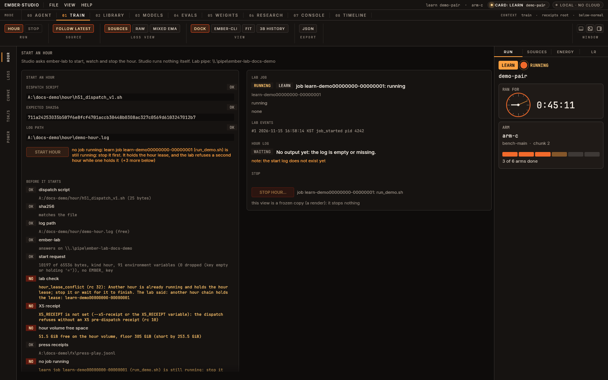

# Hour view

The form for starting a governed training hour through the lab, and the place that shows the job and stops it. It is the first rail button on [Train](train.md) (HOUR), or the HOUR button in Train's ribbon. The picture was drawn by build `edb7d3ad` on made-up data.

Studio runs nothing itself. It asks ember-lab to start, watch and stop the hour; the lab owns the job.

## What it shows

Left, **Start an hour**:

- Three fields: the **dispatch script** (a path), its **expected sha256**, and the **log path**. Each has a small status mark at the right (`OK`, `NO` or `?`).
- A **START HOUR** button. It stays off, with the first blocker written beside it, until every row below is `OK`. In the picture it is off because a job is already running and holds the hour lease: the sentence beside it reads `no job running: learn job ... is still running: stop it first`, followed by how many more blockers are listed.
- **Before it starts** lists one row per check. `NO` and `?` both block. In the picture:
  - `dispatch script`: the file exists and its size is shown.
  - `sha256`: the file's hash equals the one you typed. A `?` means the script could not be hashed, so the two cannot be compared.
  - `log path`: the log's path, with `free` when no file is there yet.
  - `ember-lab`: the lab answers on its pipe.
  - `start request`: the size of the request Studio would send (limit 65536 bytes), the kind, and how many environment variables it carries. Variables whose key is empty are dropped and counted; any variable whose name starts `EMBER_` is refused.
  - `lab check`: the lab's own refusal, in its words, with its exit code. In the picture the lab says another hour holds the lease (`hour_lease_conflict`, 32).
  - `X5 receipt`: the pre-dispatch receipt must be given (`--x5-receipt`, or the `X5_RECEIPT` variable) or the dispatch refuses (code 10).
  - `hour volume free space`: free space on the volume the hour writes to against a floor (default 305 GiB, set with `--floor-gib`).
  - `press receipts`: where Studio writes its own receipts of what it started.
  - `no job running`: an hour cannot start while the lab holds a job.

Right, in three parts:

- **Lab job**: the lab's own words about the job (the state, the kind, the id, and its events with times).
- **Hour log**: says in words what state the log file is in (`No output yet: the log is empty or missing.`), and the last lines once there are some.
- **Stop**: a STOP HOUR... button that asks for a confirmation before it sends anything. In a render it is a frozen copy and says so: `this view is a frozen copy (a render): it stops nothing`.

The right dock shows the same running job (RUN tab).

## Dispatch script names

The lab refuses a script whose name does not fit its kind. An hour script is named `h<number>_dispatch_v<number>.sh`; a learn job is `learn_<name>.sh`. The refusal appears in the `lab check` row with the lab's wording and its code (21 for the name), before anything starts. This is the lab speaking; Studio only shows it.

## Controls

| Control | What it does |
| --- | --- |
| HOUR (Train ribbon or rail) | Opens and closes this view |
| the three fields | Type the dispatch script, its sha256 and the log path. Studio reads each as you type |
| START HOUR | Sends the start request to the lab. Off with a reason until every check is `OK` |
| STOP HOUR... | Asks for confirmation, then asks the lab to stop the job. Off with a reason when nothing runs |

The same start and stop are `ember-studio press` and `ember-studio stop` on the command line, and `monitor --press` opens this view in a render (see [command line](../command-line.md)).

## Not exercised

Starting and stopping an hour was not done for this guide: the picture is a render against a stand-in lab, which refuses a second hour. [Known limits](../known-limits.md) lists it.
