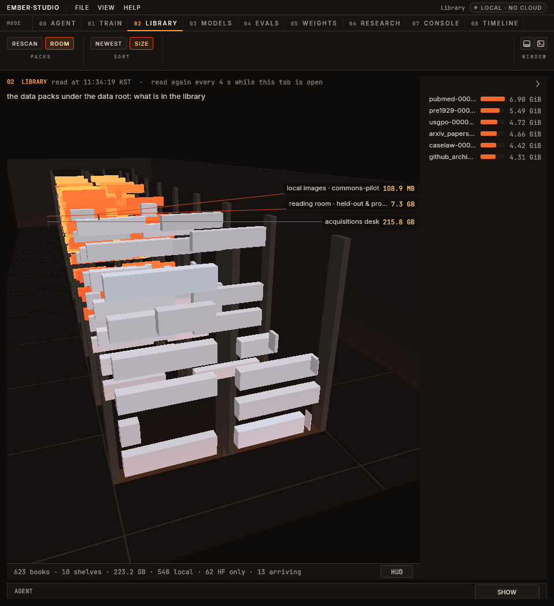
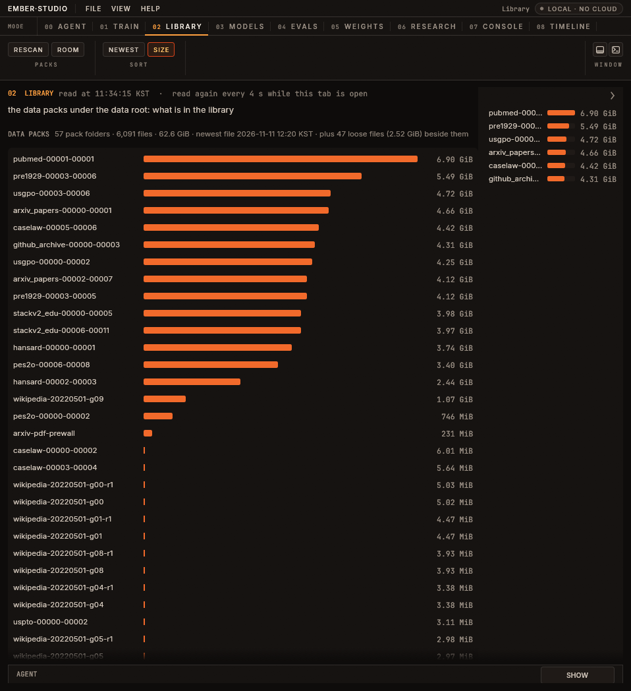
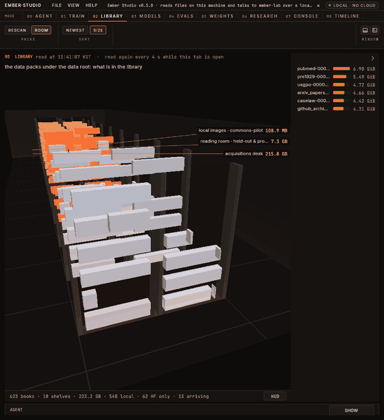

# 02 Library

The data the lab holds, as a place you can look around. Checked on build `185b8abd`.

## What it shows

The page reads the data packs under the lane root (`--data-root`) and re-reads every 4 seconds while the tab is open. Two views of the same packs:

**Room** (the default): a 3D room of shelves with every pack drawn as a book. Books are drawn in orange and pale grey; labelled callouts name areas of the room (for example a local images collection, a reading room and an acquisitions desk) with their size. A footer counts what is in the room, for example "623 books · 10 shelves · 223.2 GB · 548 local · 62 HF only · 13 arriving". A **HUD** button sits at the right of the footer (not pressed while writing this guide). A list on the right shows the largest packs.

**List**: one bar per pack folder, sorted by size, with the pack's name and its size. The header counts pack folders, files and bytes and gives the newest file's time.

If no lane root is configured the page says so and tells you the flag to give.

## Controls

| Group | Control | What it does |
| --- | --- | --- |
| PACKS | RESCAN | Reads the folders again now |
| PACKS | ROOM | Switches between the room and the list |
| SORT | NEWEST / SIZE | Orders the packs by newest file or by size; the right-hand list follows. SIZE is disabled while the list is already sorted by size |

## A typical task: find what the largest packs are

1. Open Library. Press ROOM until the list shows.
2. Read down the bars: the longest bar is the largest pack. Names are the pack folder names.
3. Press NEWEST to reorder by newest file, and RESCAN after you add packs.
4. Press ROOM again to return to the room.

*Recording: [library.mp4](../media/library.mp4).*

## Known limits of this tab

- Opening a document from a pack, and seeing which hour read which pack, are planned; they are not in this build.
- Panning and zooming the room with the mouse was not exercised while writing this guide.
