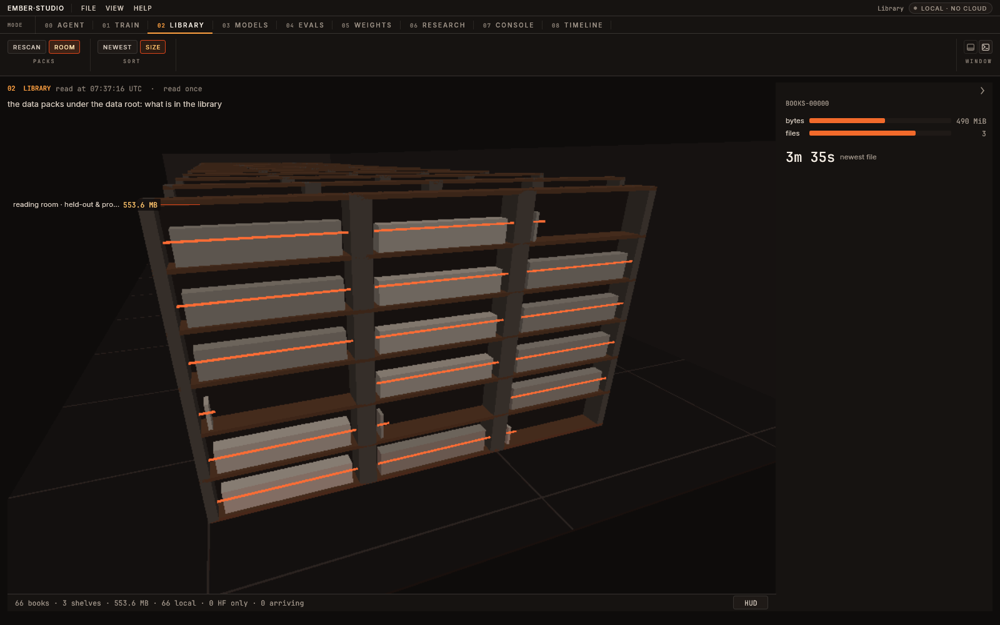

# 02 Library

The data the lab holds, as a place you can look around. The room pictures were drawn by build `be2abf05` on made-up data (see [how the pictures were made](train.md#how-the-pictures-were-made)). The list view was checked on `185b8abd`.

## What it shows

The page reads the data packs under the lane root (`--data-root`, reading `<DIR>/packed/*`) and re-reads every 4 seconds while the tab is open. Two views of the same packs.

**Room** (the default): a 3D room of shelves with every pack drawn as a book, sized by its bytes, with an orange line along its spine. Labelled callouts name areas of the room (in the picture, a reading room) with their size. A footer counts what is in the room: books, shelves, total size, how many packs are local, how many are on Hugging Face only, and how many are arriving. A **HUD** button sits at the right of the footer.

Selecting a book shows the pack in the right panel: its name, a bar for its bytes, a bar for its file count, and how long ago its newest file changed.

The selection in this picture was made with the render verb (`--select pack:NAME`, see [command line](../command-line.md)); picking a book with the mouse in the window was not exercised.

**List**: one bar per pack folder, sorted by size, with the pack's name and its size. The header counts pack folders, files and bytes and gives the newest file's time.

If no lane root is configured the page says so and names the flag: `no lane root is configured: pass --data-root DIR`.

## Controls

| Group | Control | What it does |
| --- | --- | --- |
| PACKS | RESCAN | Reads the folders again now |
| PACKS | ROOM | Switches between the room and the list |
| SORT | NEWEST / SIZE | Orders the packs by newest file or by size; the right-hand list follows. SIZE is disabled, with `already sorted by size: choose Newest to change the order`, while the list is already sorted by size |

## A typical task: find what the largest packs are

1. Open Library. Press ROOM until the list shows.
2. Read down the bars: the longest bar is the largest pack. Names are the pack folder names.
3. Press NEWEST to reorder by newest file, and RESCAN after you add packs.
4. Press ROOM again to return to the room.

*Recording: [library.mp4](../media/library.mp4), made on build `185b8abd`.*

## Known limits of this tab

- Opening a document from a pack, and seeing which hour read which pack, are planned; they are not in this build.
- Panning and zooming the room with the mouse, and the HUD button, were not exercised.
