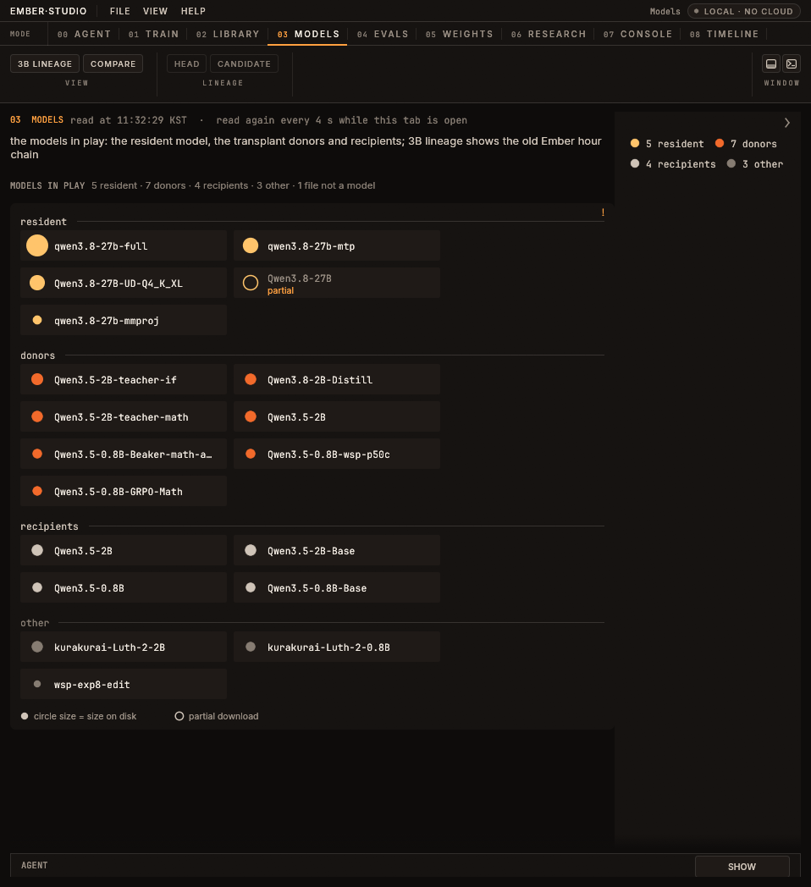

# 03 Models

The models in play, drawn as a map, the older checkpoint lineage, and a side by side compare. Checked on build `185b8abd`.

## What it shows

The page reads the models folder (`--models-root`) and groups what it finds by role.

- A summary line: for example "5 resident · 7 donors · 4 recipients · 3 other · 1 file not a model".
- Four groups. **resident**: the lab's resident models (the Agent tab chats with the resident model). **donors** and **recipients**: the models used in transplant experiments (the donor is the model whose ability is being moved, the recipient is the one it is moved into). **other**: everything else that looks like a model.
- Each model is a circle and a name. A circle's size is the model's size on disk. A hollow circle marked "partial" is a download that has not finished. A small `!` at the top right of the map is a warning for the page.
- The right panel counts the groups.

If no models folder is configured the page says so and gives the flag.

## Controls

| Group | Control | What it does |
| --- | --- | --- |
| VIEW | 3B LINEAGE | Switches the page to the older chain of training hours of the previous Ember model: every hour with its checkpoint, marked as the candidate or the head. Press again to return |
| VIEW | COMPARE | Opens a two-frame compare above the map |
| LINEAGE | HEAD / CANDIDATE | Pick the head or the candidate in the lineage chain. Disabled, with a reason, unless 3B LINEAGE is on |

### Compare

COMPARE opens two frames, **A** (left) and **B** (right). Each starts as "pick a model" and has rows for size, files and kind, with a circle between the frames for each row that fills in when the two differ.

Picking models into A and B with the mouse was not exercised while writing this guide, so what the rows show once filled is not described here.

*Recording: [models.mp4](../media/models.mp4).*

## A typical task: see which models are on disk and which are incomplete

1. Open Models. Read the summary line and the four groups.
2. Look for hollow circles marked "partial": those downloads are unfinished.
3. Press 3B LINEAGE to read the older hour-by-hour chain, and press it again to come back.
