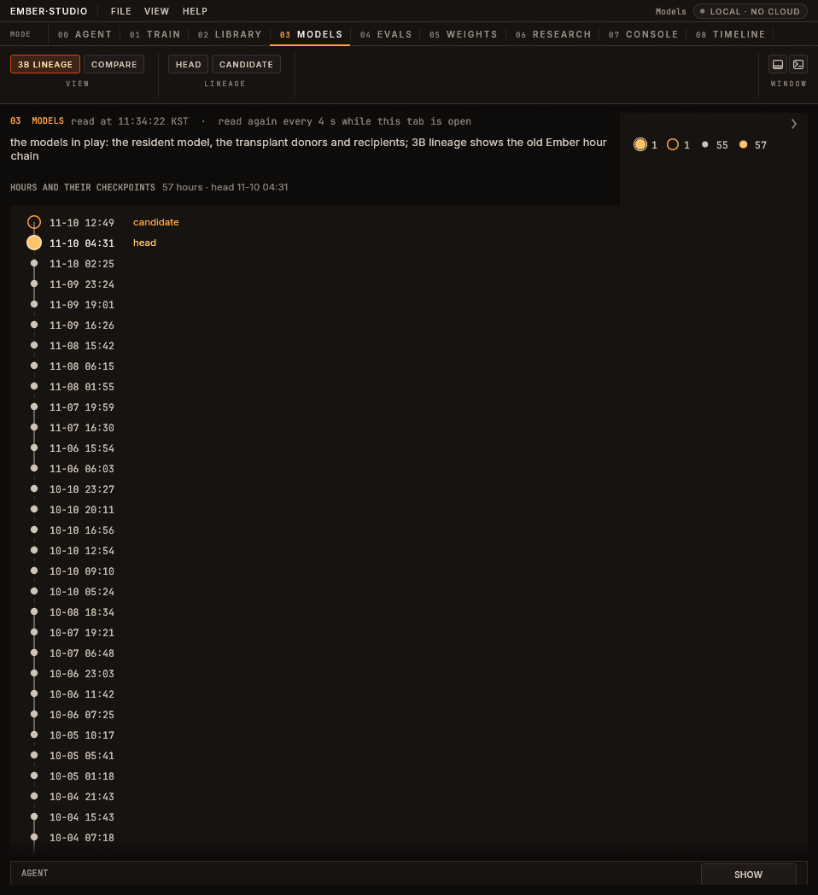
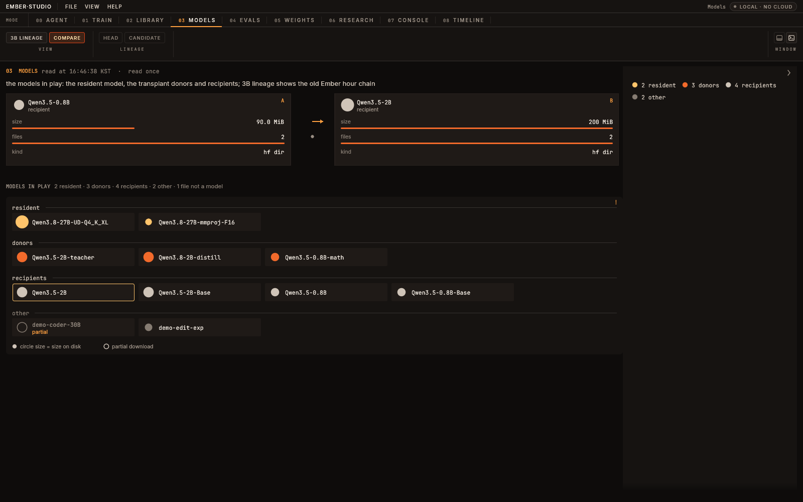
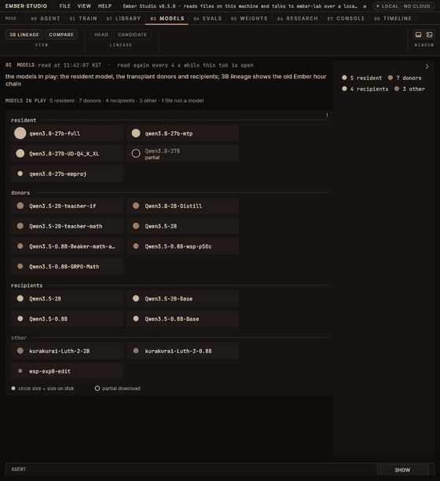

# 03 Models

The models in play, drawn as a map, the older checkpoint lineage, and a side by side compare. The map and compare pictures were drawn by build `be2abf05` offscreen on made-up folders (see [how the pictures were made](train.md#how-the-pictures-were-made)); the lineage picture and the recording are from `185b8abd`.

## What it shows

The page reads the models folder (`--models-root`) and puts each entry in a group **by its name**:

- **resident**: the name holds `qwen3.8-27b`: the lab's resident model, its variants, its vision projector, and a half-loaded download of any of them. The Agent tab chats with the resident model.
- **recipients**: a stock Qwen3.5 checkpoint, `qwen3.5-<size>` or `qwen3.5-<size>-base`. These are the models a transplant is pressed into.
- **donors**: any other name that holds `qwen3.5` or `qwen3.8-2b` (a fine-tune, a distillation or a teacher of a small Qwen): the model whose ability is being moved.
- **other**: everything else that looks like a model.

A loose file counts only if its extension says it is a model (`.gguf`, `.safetensors`, `.bin`, `.pt`, `.pth`, `.onnx`, `.ckpt`, or a `.part` of one); any other loose file is named in the hover of the caption. A folder is always a card.

- A summary line: `2 resident · 3 donors · 4 recipients · 2 other · 1 file not a model` in the picture.
- Each model is a circle and a name. A circle's size is the model's size on disk. A hollow circle marked `partial` is a download that has not finished. The `!` at the top right of the map is the page's warning (here, the one file that is not a model).
- The right panel counts the groups.

If no models folder is configured the page says so and gives the flag.

## Controls

| Group | Control | What it does |
| --- | --- | --- |
| VIEW | 3B LINEAGE | Switches the page to the older chain of training hours of the previous Ember model: every hour with its checkpoint, marked as the candidate or the head. Press again to return |
| VIEW | COMPARE | Opens a two-frame compare above the map. Disabled, with a reason, when the page holds no models |
| LINEAGE | HEAD / CANDIDATE | Pick the head or the candidate in the lineage chain. Disabled, with a reason, unless 3B LINEAGE is on |

### Compare

COMPARE opens two frames, **A** (left) and **B** (right), with an arrow between them. Each shows a model's name and role, and bars for its size, its file count and its kind. In the picture A is `Qwen3.5-0.8B` and B is `Qwen3.5-2B`; B is selected in the map below.

The picture was made by naming both models with the render verb (`--select` and `--compare-a`, see [command line](../command-line.md)). Picking models into A and B with the mouse was not exercised, and the small marks between the frames were not read, so this guide does not say what they count.

*Recording: [models.mp4](../media/models.mp4), build `185b8abd`.*

## A typical task: see which models are on disk and which are incomplete

1. Open Models. Read the summary line and the four groups.
2. Look for hollow circles marked `partial`: those downloads are unfinished.
3. Press 3B LINEAGE to read the older hour-by-hour chain, and press it again to come back.
