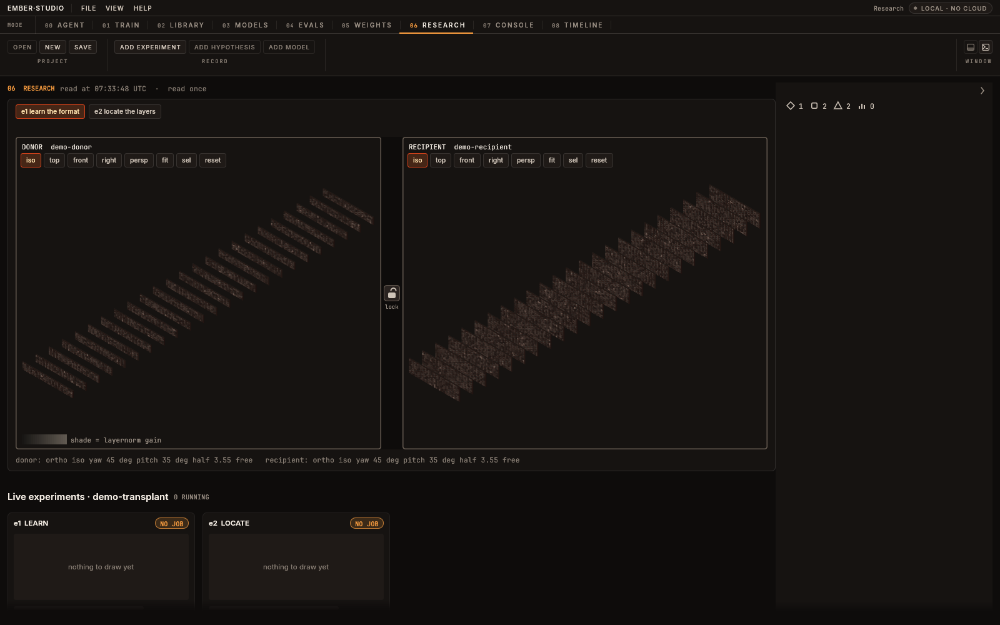
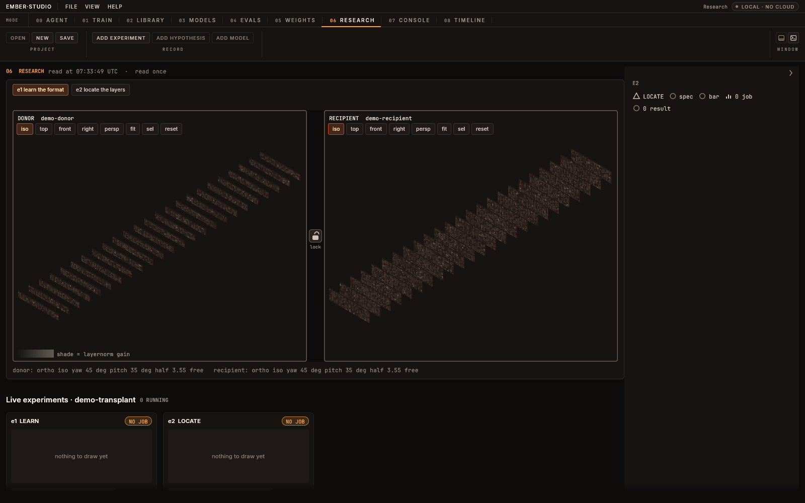
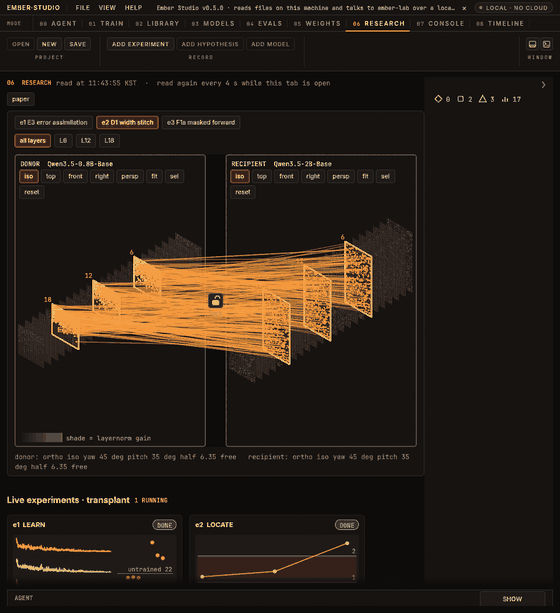

# 06 Research

A workbench for transplant experiments: a donor network and a recipient network drawn in 3D, the live experiments beneath them, a research project file, and a paper pane. The pictures were drawn by build `be2abf05` on made-up data (see [how the pictures were made](train.md#how-the-pictures-were-made)): a project named `demo-transplant` with two experiments and two small models called `demo-donor` and `demo-recipient`.

## What it shows

- **Experiment buttons** across the top choose which experiment the two 3D panes show (`e1 learn the format`, `e2 locate the layers` in the picture).
- **DONOR** and **RECIPIENT** are two framed 3D panes with a gap between them, one per model (named in each pane's header). Each layer is a plane of points; the shade is the layer norm's gain, as the legend under the pane says. Where the selected experiment has links between donor and recipient layers, they are drawn as lines. The made-up experiments here have none, so no lines show.
- Each pane has its own camera buttons: `iso`, `top`, `front`, `right`, `persp`, `fit`, `sel`, `reset`. A **lock** control between the panes ties the two cameras together. A line of text under the panes states each camera (projection, yaw, pitch, zoom).
- **Live experiments** beneath the panes is a card per experiment with its kind (here LEARN and LOCATE), its state (`NO JOB` when no job is attached, otherwise RUNNING or DONE) and a small chart of its loss or its measurement, or `nothing to draw yet`. The header counts how many are running.
- The **right panel** shows four small counters, each with an icon and no text label, until something is selected. Selecting an experiment shows its detail: its kind and four marked read-outs, spec, bar, jobs and results (below, `e2` shows LOCATE, `spec` and `bar` with empty marks, `0 job` and `0 result`).

Layer buttons (all layers, L6, L12, L18) and link lines appear for an experiment that has links; those were checked on build `185b8abd` and are not in these pictures. The recording below is of that build.

## The project

A research project is a file you open or make. With none open the page says `No research project open. File > Create new research project makes one; or give the path of a .ember file below.`

| Group | Control | What it does |
| --- | --- | --- |
| PROJECT | OPEN | Opens the project file whose path is typed in the FILE box of the project panel. Disabled, with that reason, until a path is typed |
| PROJECT | NEW | Makes a new project |
| PROJECT | SAVE | Saves the open project. Disabled, with a reason, until one is open |
| RECORD | ADD EXPERIMENT / ADD HYPOTHESIS / ADD MODEL | Add a record to the open project. Disabled, with a reason, until a project is open |
| page | experiment buttons, layer buttons, camera buttons, lock | As above |
| page | `paper` | Shows or hides the paper pane |

In the picture a project is open: NEW, SAVE and ADD EXPERIMENT are drawn bright and OPEN, ADD HYPOTHESIS and ADD MODEL dimmed (the reasons for the dimmed ones were not read). The project controls were not pressed for this guide (the project was opened with the render verb `--project FILE`), so no file was made or written.

*Recording: [research.mp4](../media/research.mp4).*

## The paper pane

The `paper` button shows or hides a pane on the right that previews a paper the project compiles: PAPER, with `source`, `recompile`, `-`, `+` and `fit` controls, a status line ("building"), and the pages as images with the time they were built. The pane is hidden in the pictures; the paper it shows belongs to the person running the program.

## A typical task: look at where a donor feeds a recipient

1. Open Research and choose an experiment with links.
2. Press L6, L12 and L18 in turn to see each layer's links, then all layers.
3. Press `top` or `front` on a pane to change its camera; press `lock` to move both together; `reset` returns.
