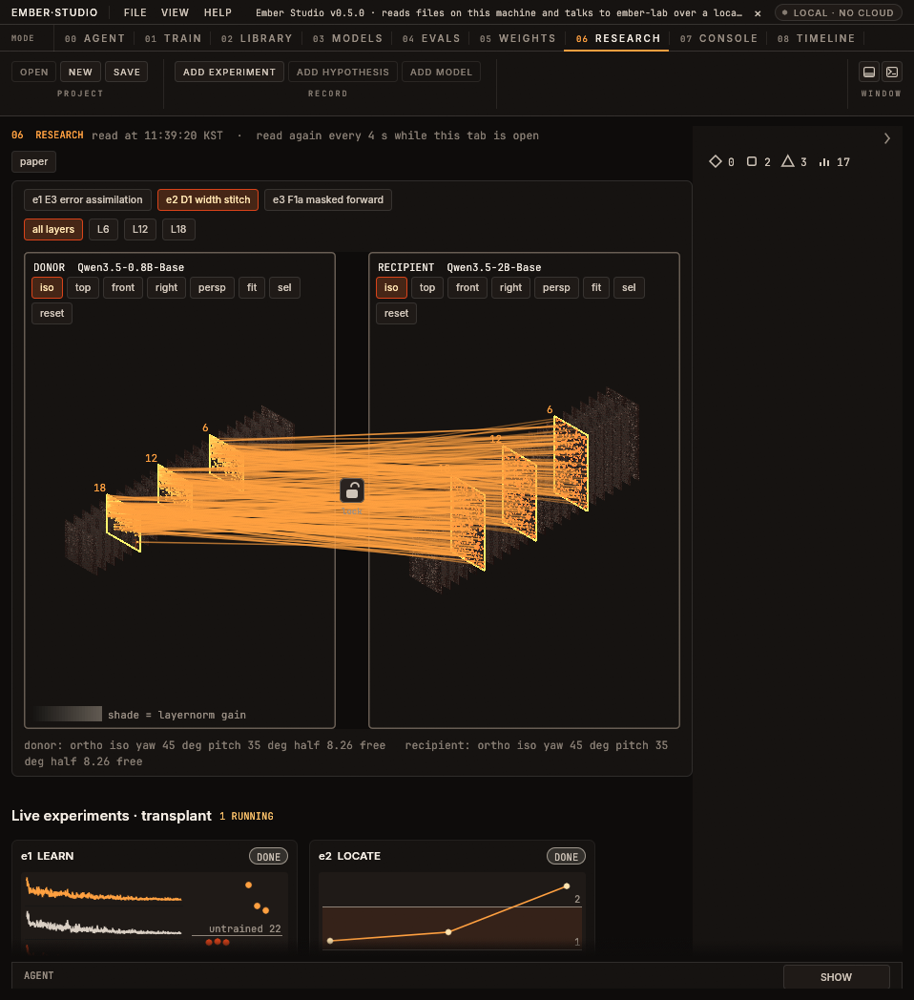

# 06 Research

A workbench for transplant experiments: a donor network and a recipient network drawn in 3D, the live experiments beneath them, a research project file, and a paper pane. Checked on build `185b8abd`.

## What it shows

- **Experiment buttons** across the top choose which experiment the two 3D panes show. Under them, **layer buttons** (all layers, L6, L12, L18) choose which layers are drawn.
- **DONOR** and **RECIPIENT** are two framed 3D panes, one per model (named in each pane's header). Each layer is a plane of points; the shade is the layer norm's gain, as the legend says. For the selected experiment the links between donor and recipient layers are drawn as lines.
- Each pane has its own camera buttons: `iso`, `top`, `front`, `right`, `persp`, `fit`, `sel`, `reset`. A **lock** control between the panes ties the two cameras together. A line of text under the panes states each camera (projection, yaw, pitch, zoom).
- **Live experiments** beneath the panes is a card per experiment with its kind (for example LEARN or LOCATE), its state (RUNNING or DONE) and a small chart of its loss or its measurement.
- The right panel shows four small counters, each with an icon. The screen does not label them, so this guide does not say what they count.

An experiment without links (the first one in the captured project is a learn run) shows the two networks without lines.

## Controls

| Group | Control | What it does |
| --- | --- | --- |
| PROJECT | OPEN / NEW / SAVE | Open a research project file, make a new one, save it |
| RECORD | ADD EXPERIMENT / ADD HYPOTHESIS / ADD MODEL | Add a record to the open project. Disabled, with a reason, until a project is open |
| page | experiment buttons, layer buttons, camera buttons, lock | As above |
| page | `paper` | Shows or hides the paper pane |

The project controls were not pressed while writing this guide, so no project file was made or opened. The experiment, layer and camera buttons and the `paper` toggle were operated and worked.

*Recording: [research.mp4](../media/research.mp4).*

## The paper pane

The `paper` button at the top shows or hides a pane on the right that previews a paper the project compiles: PAPER, with `source`, `recompile`, `-`, `+` and `fit` controls, a status line ("building"), and the pages as images with the time they were built. The screenshots in this guide have the pane hidden; the paper it shows belongs to the person running the program.

## A typical task: look at where a donor feeds a recipient

1. Open Research and choose an experiment with links.
2. Press L6, L12 and L18 in turn to see each layer's links, then all layers.
3. Press `top` or `front` on a pane to change its camera; press `lock` to move both together; `reset` returns.
