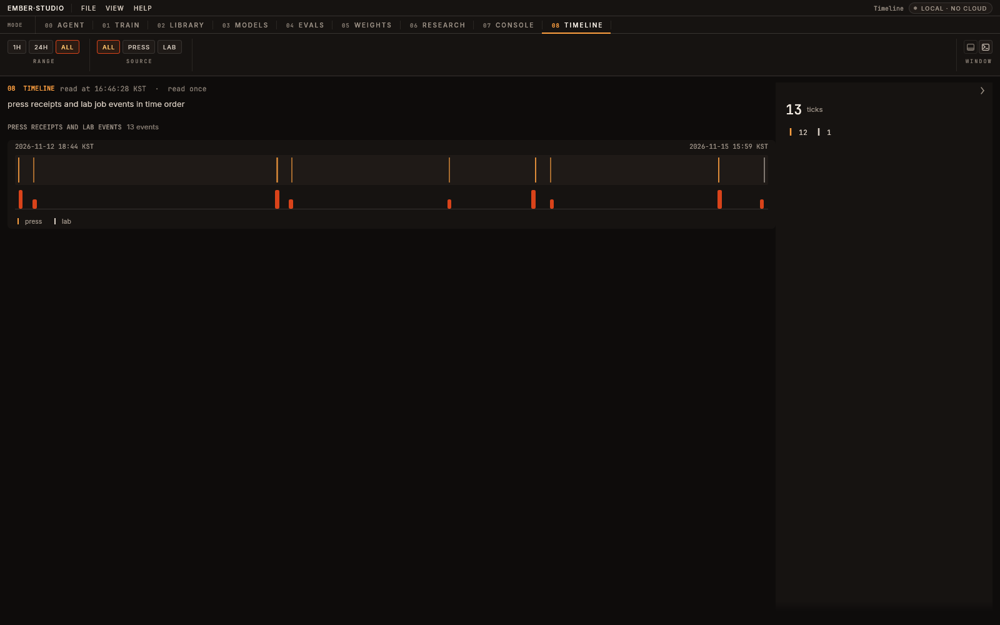
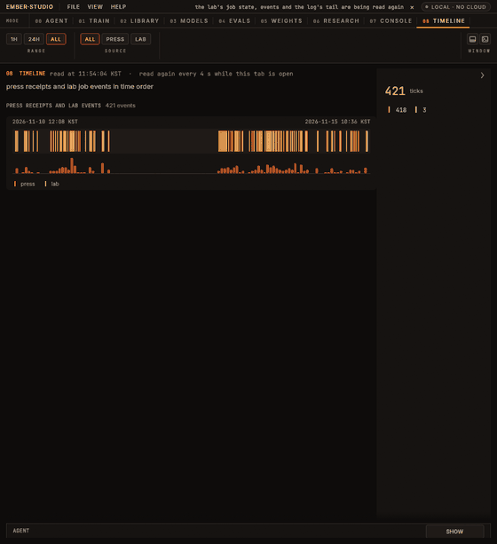

# 08 Timeline

Every press receipt and every lab job event, in time order. The picture was drawn by build `be2abf05` offscreen on made-up data (see [how the pictures were made](train.md#how-the-pictures-were-made)); the recording was made on `185b8abd`.

## What it shows

- A header counts the events (`13 events` in the picture), and a time axis states the first and last time, in the home time zone you gave with `--home-tz` (UTC when none is readable).
- A strip draws one tick per event: orange for a **press** (a start, a stop request, a stop or a refusal Studio wrote, kept in its press receipts) and white for a **lab** event. Under it a density chart shows where the events cluster.
- The right panel gives the total (`13 ticks`) and the split between press and lab (12 and 1 in the picture).

If no press receipts file is configured the page says so and names the flag.

## Controls

| Group | Control | What it does |
| --- | --- | --- |
| RANGE | 1H / 24H / ALL | Keeps the last hour, the last day or everything. When no event falls in the range the page says so |
| SOURCE | ALL / PRESS / LAB | Shows both kinds, only press receipts, or only lab events |

A control that already matches the current view is disabled and says so (`every row is already shown: choose 1h or 24h to cut the range`). 1H, 24H, PRESS and LAB were not pressed on `be2abf05`; they were operated on `185b8abd`:

*Recording: [timeline.mp4](../media/timeline.mp4), build `185b8abd`. 1H is not in the recording, because its empty state prints a local file path.*

## A typical task: see when jobs were started

1. Open Timeline with ALL range and ALL sources.
2. Press PRESS to keep only the start and stop requests.
3. Press 24H or 1H to zoom to recent activity.
