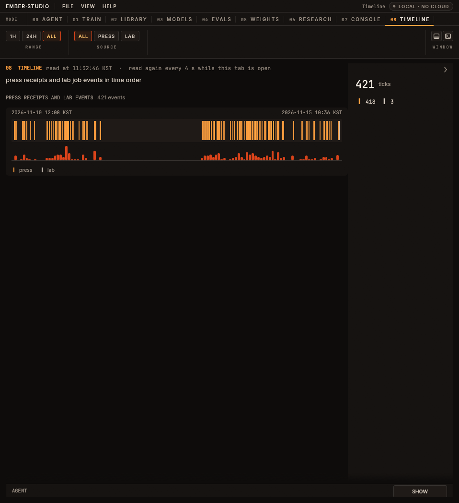

# 08 Timeline

Every press receipt and every lab job event, in time order. Checked on build `185b8abd`.

## What it shows

- A header counts the events, for example "421 events", and a time axis states the first and last time.
- A strip draws one tick per event: orange for a **press** (a start or stop request Studio wrote, kept in its press receipts) and white for a **lab** event. Under it a density chart shows where the events cluster.
- The right panel gives the total ("421 ticks") and the split between press and lab (418 and 3 in the captured data).

If no press receipts file is configured the page says so and names the flag.

## Controls

| Group | Control | What it does |
| --- | --- | --- |
| RANGE | 1H / 24H / ALL | Keeps the last hour, the last day or everything. When no event falls in the range the page says so |
| SOURCE | ALL / PRESS / LAB | Shows both kinds, only press receipts, or only lab events |

A control that already matches the current view is disabled and says so.

*Recording: [timeline.mp4](../media/timeline.mp4). 1H is described above but not in the recording, because its empty state prints a local file path.*

## A typical task: see when jobs were started

1. Open Timeline with ALL range and ALL sources.
2. Press PRESS to keep only the start and stop requests.
3. Press 24H or 1H to zoom to recent activity.
