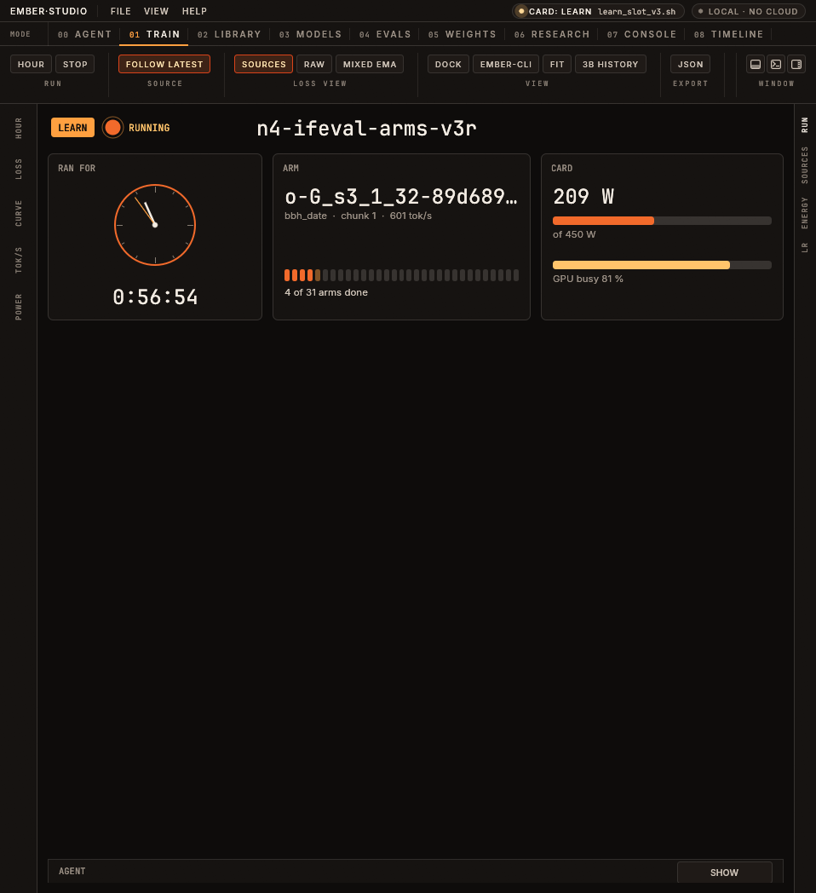
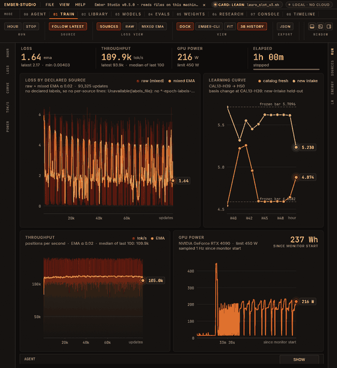
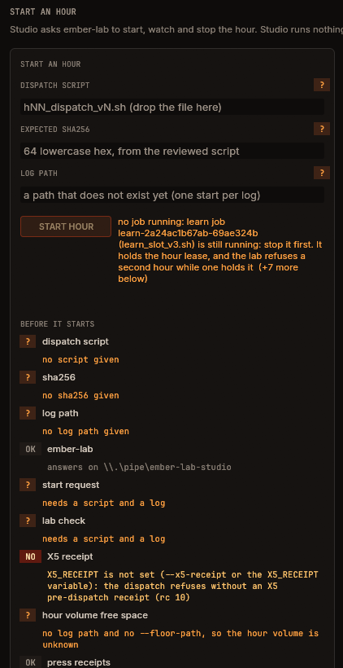
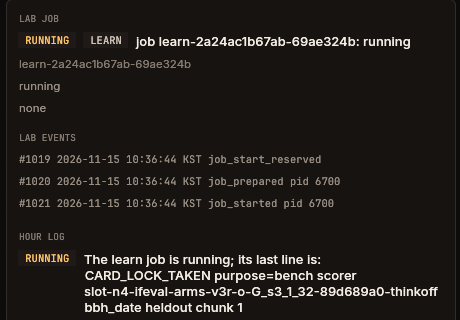

# 01 Train

The job the lab is running now, the Hour view for starting, watching and stopping an hour, and the charts of earlier hours. Checked on build `185b8abd`.

## What it shows

With a job running, the page shows it as three cards: how long it has run, which arm it is on, and the GPU card.

- A badge (LEARN or the hour kind) and RUNNING with a spinner, then the job's name.
- **RAN FOR**: a clock and an elapsed time.
- **ARM**: the arm being scored, its data source, chunk and tokens per second, and a bar of arms done ("4 of 31 arms done").
- **CARD**: power draw against the card's limit, and how busy the GPU is.

Press **3B HISTORY** to see the charts of the earlier training hours instead: four tiles (loss, throughput, GPU power, elapsed) and four charts (loss by source, the learning curve across hours against its frozen bars, throughput, GPU power).

## Controls

| Group | Control | What it does |
| --- | --- | --- |
| RUN | HOUR | Opens the Hour view (below); press again to close it |
| RUN | STOP | Asks the lab to stop the followed job. Disabled with a reason when nothing is running |
| SOURCE | FOLLOW LATEST | On: follow the newest source. Off: stay on the one being read |
| LOSS VIEW | SOURCES / RAW / MIXED EMA | Which loss lines the loss chart draws: per source, the raw mixed loss, or its moving average |
| VIEW | DOCK | Shows or hides the right dock ([window](../window.md#right-dock-train)) |
| VIEW | EMBER-CLI | Shows or hides the ember-cli panel |
| VIEW | FIT | Puts every chart back to all its data |
| VIEW | 3B HISTORY | Toggles between the running job's cards and the charts of the earlier hours |
| EXPORT | JSON | Copies the current snapshot, as JSON, to the clipboard (not exercised here) |

Operated while writing this guide: HOUR, RAW, MIXED EMA, SOURCES, DOCK, EMBER-CLI, 3B HISTORY and the rail buttons. FOLLOW LATEST, FIT, JSON and STOP are described from their labels and were not pressed (a real job was running, so STOP was never touched).

The **left rail** (HOUR, LOSS, CURVE, TOK/S, POWER) takes one chart across the whole canvas; press the same button again to give the four back.

*Recording: [train.mp4](../media/train.mp4). RAW and MIXED EMA change the loss lines; CURVE and POWER take a chart across the canvas.*

## The Hour view

HOUR opens a view for starting a governed training hour through the lab. Studio runs nothing itself: it asks ember-lab to start, watch and stop the hour.

- **Start an hour** has three fields (dispatch script, expected sha256, log path) and a START HOUR button. Under **Before it starts** there is one row per check, each OK, NO or `?`. A `?` blocks the same as NO. START HOUR stays disabled, with the first blocker written beside it, until every row is OK.
- In the screenshot the start is blocked on purpose: a job is already running and holds the lease, so the reason beside the button says so and the X5 receipt row says why it is NO.
- **Lab job** shows the lab's own words about the job (RUNNING, the kind, the id, its events with times), **Hour log** says in words what state the log is in, and **Stop** holds the STOP HOUR... button, which asks for a confirmation before it sends anything.

Starting and stopping an hour were not exercised while this guide was written, because a real job was running. [Known limits](../known-limits.md) says so.

## A typical task: watch a running job

1. Open Train. The cards follow the job the lab reports.
2. Press 3B HISTORY if you want the loss and throughput charts of earlier hours, and RAW or MIXED EMA to change the loss lines.
3. Open [Console](console.md) for the job's events and log tail, or [Timeline](timeline.md) for every receipt in time order.
