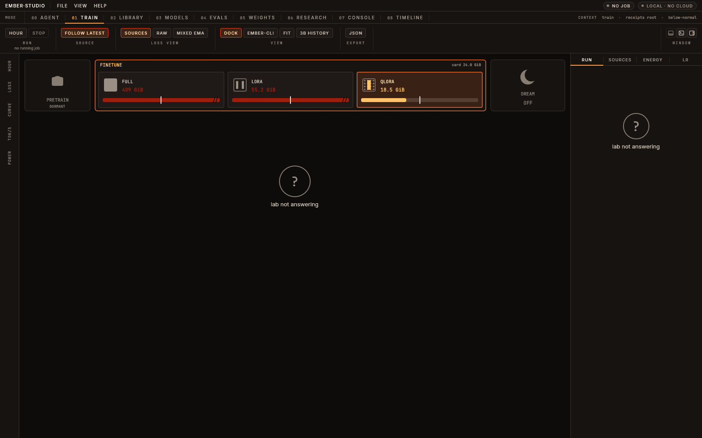
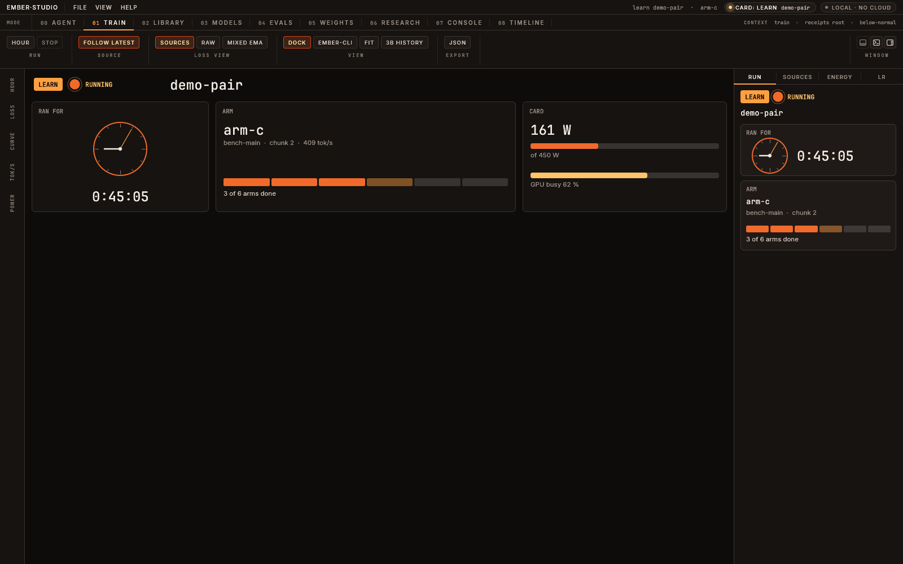
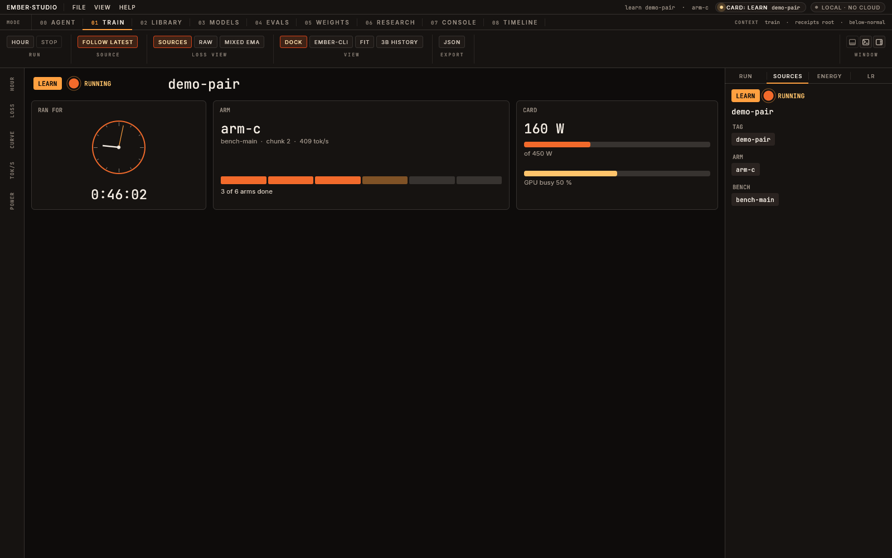

# 01 Train

The job the lab is running now, as three cards; the right dock with its four tabs; and the way into the [Hour view](hour-view.md) for starting, watching and stopping an hour. The mode strip picture was drawn by build `de6494fe`; the job and dock pictures were drawn by `edb7d3ad` and the 3B history picture by `185b8abd`; see [how the pictures were made](#how-the-pictures-were-made).

## What it shows

Above every view of the tab (the job cards, the Hour view and the 3B history) sits a **mode strip**. This is what the tab looks like on the current build with no lab answering:

- **PRETRAIN** is drawn dormant: greyed, with a padlock and the word DORMANT. It cannot be chosen, from the window or from a script, and its disabled reason says it is off until there are far more GPUs and far more compute. The lab refuses a pretrain job too, so no client can start one.
- **FINETUNE** is the live mode. Its three methods are **FULL** (every weight trains), **LORA** (frozen 16-bit weights and small adapters) and **QLORA** (frozen 4-bit weights and small adapters). The chosen one is framed; `--act train.method.lora`, or `--act-set train.method lora`, chooses it from any tab.
- Each method shows how much memory it needs against the card as a bar and a number, with a tick at the card's memory (the bar runs to twice the card): `fits`, `tight` (within 15 percent of the card) or `over the card`. The figures are estimates for a model of 27.45 billion parameters: 16 bytes per parameter for FULL (weights, gradients and two optimizer moments), 2.16 for LORA and 0.72 for QLORA; activations come on top. The card's memory is read from the GPU driver; with no reading Studio assumes 24 GiB and says `(assumed)`. In the picture, a made-up render with no reading: FULL 409 GiB and LORA 55.2 GiB are over the card, QLORA 18.5 GiB fits.
- **DREAM** is a badge, not a mode: a crescent that reads `off`, and lights up by itself while the lab holds a running job of kind `dream`.

Below the strip, the body follows the lab: with nothing from it, `lab not answering` (the picture); otherwise the job as below.

With a job running, the page shows it as three cards: how long it has run, which arm it is on, and the GPU card.

- A badge (LEARN, or the hour kind) and RUNNING with a spinner, then the job's name (in the picture, `demo-pair`).
- **RAN FOR**: a clock and an elapsed time.
- **ARM**: the arm being scored, its data source (`bench-main` here), its chunk, tokens per second once the log has them, and a bar of arms done ("3 of 6 arms done").
- **CARD**: power draw against the card's limit, and how busy the GPU is.
- The **menu bar** chip at the top right names what holds the card (`CARD: LEARN demo-pair`).

The **right dock** has four tabs: RUN, SOURCES, ENERGY and LR. RUN repeats the job's badge, clock and arm bar in a narrow column. SOURCES lists the tag, arm and bench the job is reading.

ENERGY and LR were not drawn for this guide.

With no job and nothing from the lab, the page says `lab not answering` (no release of the lab has been published; see [Known limits](../known-limits.md)). With a lab that answers and holds no job it says `no jobs`. The old 3B hour charts (loss by source, the learning curve, throughput, power) are still there behind **3B HISTORY**; they read the receipts of earlier hours from `--root`. They were checked on build `185b8abd` and not redrawn for this guide:

## Controls

| Group | Control | What it does |
| --- | --- | --- |
| RUN | HOUR | Opens the [Hour view](hour-view.md); press again to close it |
| RUN | STOP | Asks the lab to stop the followed job. Disabled, with the reason `no running job found: nothing to stop`, when nothing is running |
| SOURCE | FOLLOW LATEST | On: follow the newest source. Off: stay on the one being read |
| LOSS VIEW | SOURCES / RAW / MIXED EMA | Which loss lines the loss chart draws: per source, the raw mixed loss, or its moving average |
| VIEW | DOCK | Shows or hides the right dock |
| VIEW | EMBER-CLI | Shows or hides the ember-cli panel |
| VIEW | FIT | Puts every chart back to all its data |
| VIEW | 3B HISTORY | Switches between the running job's cards and the charts of the earlier 3B hours |
| EXPORT | JSON | Copies the current snapshot, as JSON, to the clipboard |
| WINDOW | three icons | Agent drawer, ember-cli panel and the dock; a dock history toggle draws the old 3B hour rows in the dock's four tabs instead of the job the lab holds |

The **left rail** (HOUR, LOSS, CURVE, TOK/S, POWER) takes one chart across the whole canvas; press the same button again to give the four back. HOUR is the Hour view; the other four are the charts.

On the current build, `de6494fe`, only the page with no lab was drawn (the mode strip picture), and `ui-tree` was read for the controls below. Operated for this guide, on build `edb7d3ad` offscreen: the page with a running job, the dock's RUN and SOURCES tabs, and the Hour view. Described from the control list, not pressed: FOLLOW LATEST, FIT, JSON and STOP, and the dock's ENERGY and LR tabs. A recording of the earlier build is in [media](../media/README.md).

## How the pictures were made

The pictures on this page, [Hour view](hour-view.md), [Agent](agent.md), [Library](library.md) and [Research](research.md) are not screenshots of anyone's session. They were drawn by `ember-studio monitor --render-png` (see [command line](../command-line.md)), which draws the real window offscreen: no window opens, no GPU is used and no focus is taken. The data is made up: a folder of small fake packs and models, and, for the job pictures, a stand-in lab that answers the lab's pipe with one scripted job named `demo-pair`. The stand-in lab is not ember-lab; it only lets the page draw a running job. The mode strip, Library and Agent pictures drawn on `de6494fe` used no lab at all; their folders were made-up ones passed with the root flags, because a render without them looks for the usual folders on the machine it runs on.

## A typical task: watch a running job

1. Open Train. The cards follow the job the lab reports.
2. Press RAW or MIXED EMA to change the loss lines (3B HISTORY on), or open the dock's SOURCES tab to see what the job reads.
3. Open [Console](console.md) for the job's events and log tail, or [Timeline](timeline.md) for every receipt in time order.
4. To start or stop an hour, use the [Hour view](hour-view.md).
