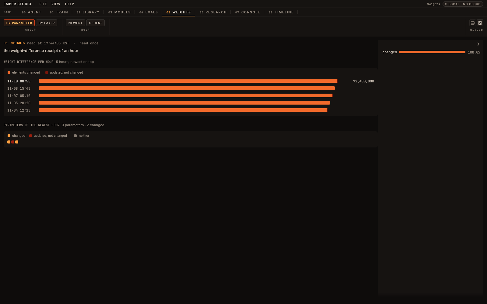
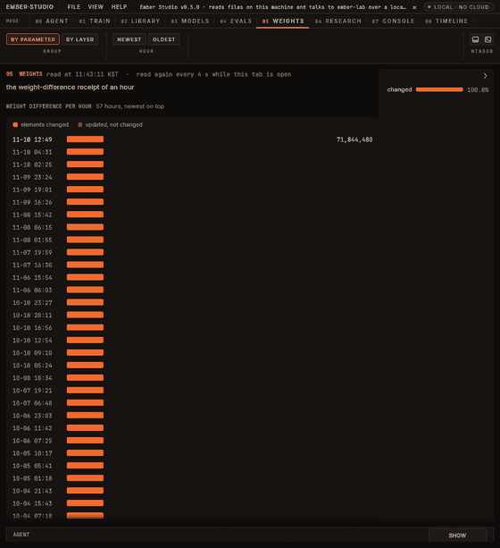

# 05 Weights

How much of a model's weights each training hour changed. The picture was drawn by build `edb7d3ad` offscreen on made-up hour receipts (see [how the pictures were made](train.md#how-the-pictures-were-made)); the recording is from `185b8abd`.

## What it shows

The page reads the weight-difference receipt of every hour (from the receipts root, `--root`) and draws one row per hour, newest on top.

- The header counts the hours (`5 hours, newest on top`).
- The legend: orange is **elements changed**; dark red is **updated, not changed**.
- Each row is an hour (month-day and time in the home time zone) and a bar. The newest row also prints its count of changed elements (72,408,000 in the picture; the numbers are made up).
- Under it, **parameters of the newest hour** draws one square per parameter: changed, updated but not changed, or neither.
- The right panel shows the share changed for the selected hour.

If no receipts root is configured the page says so and gives the flag.

## Controls

| Group | Control | What it does |
| --- | --- | --- |
| GROUP | BY PARAMETER / BY LAYER | Chooses whether the rows are one per parameter or grouped by layer. The one in use is disabled, with a reason |
| HOUR | NEWEST / OLDEST | Selects the newest or the oldest hour |

BY LAYER and the HOUR buttons were not pressed on `edb7d3ad`; they were operated on `185b8abd`:

*Recording: [weights.mp4](../media/weights.mp4), build `185b8abd`.*

## Known limits of this tab

- The page shows counts only. It does not show tensors, per-layer histograms or gradients; those are planned under the Inspect capability.
- It reads only the weight-difference receipts that the earlier 3B hours wrote; it reads no other kind of run.
- In the data captured on `185b8abd` every hour's bar was full. BY LAYER was pressed and the page redrew, but the first screen looked the same as BY PARAMETER, so this guide does not describe what the layer grouping adds.
