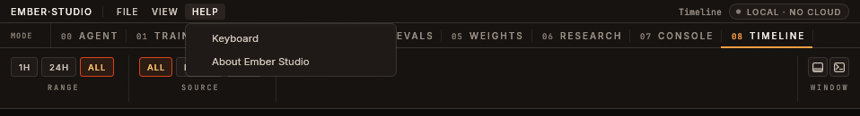
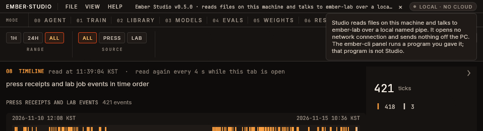
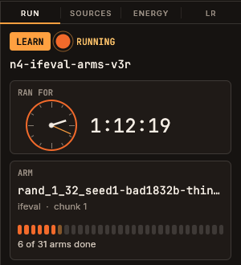

# The window: menus, ribbon, docks, keys

The parts of the window that are the same on every tab. Checked on build `185b8abd`.

## Menu bar

- **FILE**, **VIEW**, **HELP** open lists; Esc or a click elsewhere closes one.
- HELP has **Keyboard** and **About Ember Studio**. Each leaves a one-line note in the menu bar (an × dismisses it). Keyboard lists the keys below; About says the version (v0.5.0 in this build) and that Studio "reads files on this machine and talks to ember-lab over a local named pipe" and starts and stops nothing itself.
- The two chips on the right:
  - the **card chip** names what holds the GPU card now, for example a learn job and its script (it is absent when nothing holds the card);
  - **LOCAL · NO CLOUD** opens a sentence: Studio reads files on this machine and talks to ember-lab over a local named pipe, opens no network connection and sends nothing off the PC; the ember-cli panel runs a program you gave it and that program is not Studio.

## Mode tabs

`00 AGENT`, `01 TRAIN`, `02 LIBRARY`, `03 MODELS`, `04 EVALS`, `05 WEIGHTS`, `06 RESEARCH`, `07 CONSOLE`, `08 TIMELINE`. Choosing one shows that page at once. The ribbon below the tabs changes with the tab; the groups it shows are listed on each [tab page](tabs/).

## Ribbon

Buttons come in groups with a small caption under each group (RUN, SOURCE, LOSS VIEW, VIEW, EXPORT, WINDOW on Train). Some buttons are toggles and show an orange outline while on. A disabled button states its reason. The **WINDOW** group at the right of every ribbon has icon buttons: one shows or hides the agent drawer, one shows or hides the ember-cli panel, and Train has a third for the right dock.

## Keys

`Ctrl+1` to `Ctrl+8` pick a mode (Train to Timeline), `Ctrl+9` picks the Agent tab, `` Ctrl+` `` (control and the backtick key) shows or hides the ember-cli panel, Tab moves between controls, Enter or Space presses the focused one, Esc closes a list.

## Right dock (Train)

A tab strip on the right edge of Train: RUN, SOURCES, ENERGY, LR. RUN shows the lab job's clock, the arm being scored and the card; SOURCES, ENERGY and LR are the other three tabs of the dock (not captured in the screenshots here). In a narrow window the strip is vertical and only labels show; at about 1400 pixels wide the dock opens as a panel.

## Agent drawer

A collapsed strip labelled AGENT at the foot of every page. SHOW opens the agent as a panel at the foot of the page you are on, with its state, mode buttons, transcript and message box; HIDE puts it away.

## ember-cli panel

A terminal panel for one program you name at start (`--cli-exe`). Without one it says `no program configured: give --cli-exe PATH or set EMBER_STUDIO_CLI_EXE` and starts nothing. It is a convenience; starting, watching and stopping a job is done with the Train tab's own controls.

## One window, always

There is no way to open a second Studio window. A second launch sends its arguments to the first and exits with `STUDIO_ALREADY_RUNNING pid=<n>`. This is on purpose: one window means one owner of the screen and no two windows fighting over the same lab.

## CPU and priority

Studio is deliberately light. In this build the window pins itself to logical CPUs 30 and 31 at below-normal priority when the machine has them, so it never competes with a training job for cores. On a machine with fewer CPUs the pin is skipped. `EMBER_STUDIO_CPU_MASK` overrides it.
